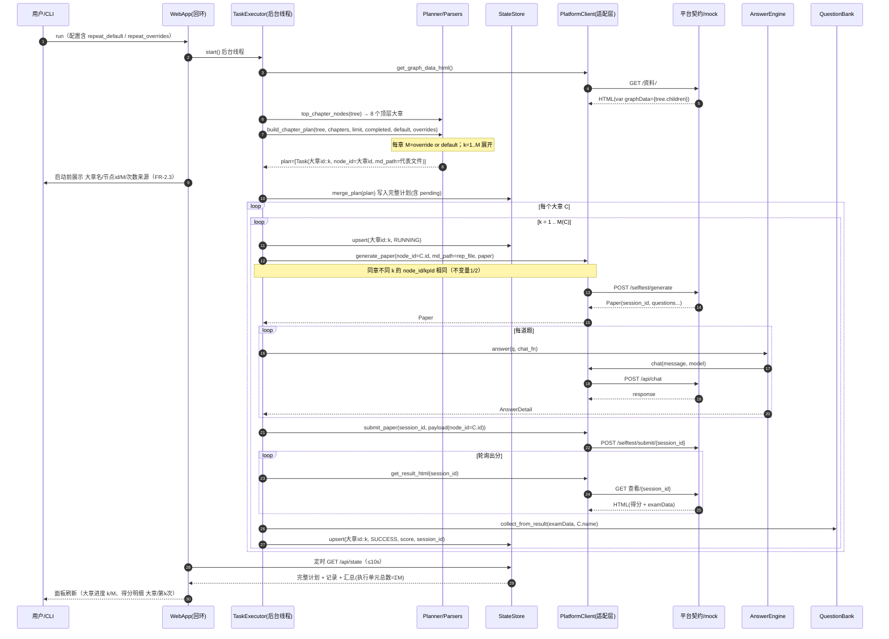
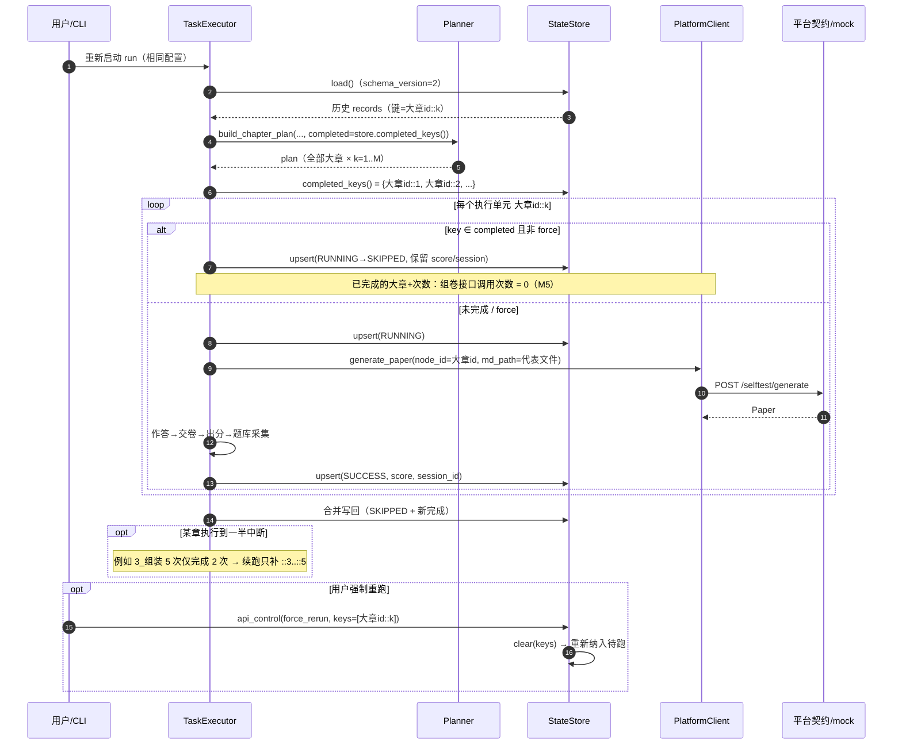
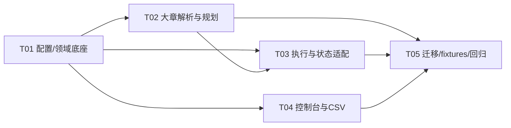

# 章节自测复习助手 — 增量系统设计（design-v2-delta）

| 项目 | 内容 |
| ---- | ---- |
| 文档类型 | 增量设计与任务分解（在 v1 `design.md` 基础上做最小改动） |
| 版本 | v2-delta（认知纠正型变更：796 小文件 → 顶层大章 × 每章 N 次） |
| 作者 | 架构师（高见远） |
| 上游输入 | `docs/PRD-v2-delta.md`、`docs/design.md`、`docs/site-verification-2026-11-21.md`（§7 / §7.4）、`docs/PRD-confirmed.md` |
| 基线 | v1.1 确认版 + v1 `design.md`（20 源文件、119 用例） |
| 语言 | 简体中文 |
| 技术栈 | 沿用 v1：Python 3.10+ 仅标准库 + 原生 HTML/CSS/JS，零第三方包、零前端构建 |
| 合规声明 | 全文无真实账号/密码/Cookie；不调用任何有副作用的真实组卷/交卷接口 |

> **阅读方式**：本文只写"相对 v1 的增量"。未提及部分一律沿用 `design.md`；站点事实以核验 §7 / §7.4 为最高优先级。
> **总原则**：**加法式最小改动**——尽量新增函数/字段、保留 v1 已验证的旧函数与 119 个用例，避免重写。

---

## 1. 变更总览表（v1 → v2）

| # | 设计点 | v1（design.md） | v2（本文） | 影响到的具体文件 | 改动级别 |
| - | ------ | --------------- | --------- | ---------------- | -------- |
| 1 | 任务模型 | 任务 = 单个 `.md`，约 796 个；按文件拆分 | 任务 = （顶层大章 C, 第 k 次），`M(C)=override or default`；总量 `ΣM(C)` ≈ 27~114 | `planner.py`、`models.py`、`main.py` | **重构（新增函数，保留旧函数）** |
| 2 | 唯一键 | `make_unique_key = node_id::normalize_md_path` | 新增 `make_task_key = 大章节点id::第k次`（如 `20260907180845_0005::3`）；旧函数保留兼容 | `utils.py`、`models.py`、`planner.py` | 新增函数 |
| 3 | 树解析 | 递归 `iter_tree_nodes` 收集全树文件（796） | 新增 `top_chapter_nodes(tree)` 取顶层大章；新增 `representative_file`；旧递归函数保留 | `parsers.py` | 新增函数 |
| 4 | config schema | `limit`（文件套数）、无重复参数 | 新增 `repeat_default=3`、`repeat_overrides={}`；新增正向整数校验；`limit` 语义改为"大章数" | `config.py`、`models.py`、`config.example.json` | 增量字段 |
| 5 | planner | `build_plan` 递归文件、按路径内容筛选 | 新增 `build_chapter_plan`：选大章 → 按章展开 k=1..M；`chapters` 改为筛大章；`limit` 截断大章数 | `planner.py`、`main.py` | 新增函数 |
| 6 | executor | `generate(task)` 用 `task.node_id/md_path`（逐文件） | 逻辑基本不变：`node_id` 传入即大章 id；仅日志/记录描述改为"大章名 第k次" | `executor.py` | 极小改动 |
| 7 | state_store | 按字符串唯一键 upsert/完成判定 | **结构不变**；仅唯一键取值变化；新增 `schema_version=2` 与 v1 记录隔离/备份 | `state_store.py` | 极小改动（迁移） |
| 8 | Web/UI | "文件"列、任务总数=文件数 | "大章/第k次"列、大章进度 k/M、执行单元总数=ΣM；搜索按大章/第k次 | `webapp.py`、`static/app.js`、`static/index.html` | 展示层改动 |
| 9 | CSV 导出 | 列含 `md_path/file_name` | 增加 `repeat_index/repeat_source` 列，保留旧列 | `exporters.py` | 增量列 |
| 10 | 测试 | 119 用例（11 文件） | 旧函数保留 → 119 用例保持绿；新增 v2 用例文件覆盖新验收点 | `tests/test_v2_chapter_model.py`（新增）、`tests/fixtures/sample_data.py` | 新增用例 |
| 11 | 平台适配层 | `generate_paper(node_id, md_path, paper)` | **不改**：站点按 `node_id` 计数，传大章 id 即正确 | `platform_client.py` | **不改** |
| 12 | 合规 | 两条红线为"必须问" | 已确认解除（允许自动化、允许导出）；产品伦理边界不变 | 仅文档/文案，无代码 | 不改代码 |

> **依赖包：无新增**。不引入任何第三方库，不增加前端构建步骤；`requirements.txt`、`.gitignore`、`static/app.css` 保持不变。

---

## 2. 最小改动策略

### 2.1 必须改的文件与改法要点

| 文件 | 改法要点（签名 / 逻辑变化） | 是否破坏旧接口 |
| ---- | -------------------------- | -------------- |
| `models.py` | ① `Task` **新增两个带默认值的字段** `repeat_index:int=1`、`repeat_source:str="default"`；新增 `from_chapter_and_repeat(...)` 构造器与 `label` 属性（"大章名 第k次"，无 k 时回退 `file_name`）。② `AppConfig` 新增 `repeat_default:int=3`、`repeat_overrides:Dict[str,int]={}`；`_from_dict`/`to_dict`/`apply_env_overrides` 的字段清单补两键。③ `RunState.summary()` 的 `by_chapter` 增加 `repeat_source` 字段（total/done 天然= M/k）。 | 否（新字段有默认值；`from_node_and_path` 保留） |
| `utils.py` | **保留** `make_unique_key` / `normalize_md_path` / `chapter_from_path` 全部不动；**新增** `make_task_key(node_id, repeat_index) -> f"{node_id.strip()}::{int(k)}"`。 | 否 |
| `config.py` | `DEFAULT_CONFIG` 增 `repeat_default=3`、`repeat_overrides={}`；`_ENV_MAP` 增 `CQA_REPEAT_DEFAULT`（int）；`validate_config` 增校验（用 `data.get(...,默认)` 取值为旧配置兜底）；`template()` 自动含新键。 | 否 |
| `config.example.json` | 增加两个字段占位（无真实值）。 | 否 |
| `parsers.py` | **保留** `iter_tree_nodes`/`node_files`/`parse_graph_data`；**新增** 纯函数 `top_chapter_nodes(tree)` 与 `representative_file(chapter, tree=None)`；解析 0 个大章抛 `ParseError("平台页面结构可能变化…")`。 | 否 |
| `planner.py` | **保留** `build_plan`（旧 119 用例依赖）；**新增** `build_chapter_plan(...)` 与 `match_chapter_node(chapter_node, whitelist)`；`Planner` 门面新增 `build_chapter_plan` 静态方法；`parse_limit_argument` 保留（语义注释改为"大章数"）。 | 否 |
| `main.py` | `_fetch_plan` 改调 `build_chapter_plan` 并传 `repeat_default/repeat_overrides`；`_print_plan` 表头"文件"→"大章/第k次（来源）"，输出 `task.label`；`cmd_config` 增 `repeat_default` 提示。 | CLI 行为变，函数签名兼容 |
| `executor.py` | `generate(task)` 保持 `client.generate_paper(task.node_id, task.md_path, ...)`（正确）；把 `_log("开始复习任务：{task.file_name}")` 改为 `task.label`；提交仍用回传的 `paper.node_id`。 | 否 |
| `state_store.py` | 读写逻辑不变；`save()` 时写入 `schema_version=2`；`load()` 检测 v1（无该字段/值为 1）→ 一次性备份旧文件到 `data/state.v1.<ts>.json` 后返回空状态（详见 §6）。 | 否（对 v2 文件透明） |
| `webapp.py` | `api_records` 搜索串增 `task.label`/`repeat_index`；`api_state` 无需改（`summary` 由 `RunState` 提供，分母已=执行单元总数）。 | 否 |
| `static/app.js` / `index.html` | 总览与记录表"文件"列改"大章/第k次"；进度行显示 `done/total`（即 k/M）与"次数来源"；范围行显示默认/覆盖次数；文案保持复习导向。 | 否 |
| `exporters.py` | `records_csv` 的 `columns` 末尾追加 `repeat_index`、`repeat_source`（保留旧列，缺字段用空串）；其余导出不动。 | 否 |

### 2.2 明确不改的文件（含理由）

| 文件 | 不改理由 |
| ---- | ------- |
| `platform_client.py` | `generate_paper(node_id, md_path, paper)` 契约不变；核验 §7.2a 证明"计数键=传入 node_id"，传大章 id 即可，无需改客户端；`submit_paper` 沿用回传 node_id。 |
| `answer_engine.py` | 作答/HTTP 解耦逻辑与大章模型无关。 |
| `bank.py`、`logger.py` | 题库去重/日志脱敏与任务模型正交。 |
| `requirements.txt`、`.gitignore`、`static/app.css`（可选微调） | 无新依赖；学术简洁风规范沿用。 |

---

## 3. 新数据结构 / 接口变更

### 3.1 唯一键生成（放 `utils.py`）

```python
def make_task_key(node_id: str, repeat_index: int) -> str:
    """v2 全链路主键：大章节点 id :: 第 k 次（k 从 1 开始）。"""
    return f"{str(node_id or '').strip()}::{int(repeat_index)}"
# 例：make_task_key("20260907180845_0005", 3) -> "20260907180845_0005::3"
```
- 旧 `make_unique_key(node_id, md_path)` **保留但不再用于新计划**（兼容旧数据与旧用例）；新计划全程用 `make_task_key`。
- 归一化只作用于键；组卷请求的 `md_path` 仍用**原始代表文件路径**（保留反斜杠与中文，仅非 ASCII 做 URL 编码，沿用 design §7.1）。

### 3.2 `Task` 实体字段变化

| 字段 | v1 | v2 | 说明 |
| ---- | -- | -- | ---- |
| `unique_key` | `node_id::path` | `大章id::k` | 由 `make_task_key` 生成 |
| `node_id` | 文件/子节点 id | **固定=大章顶层节点 id** | 同章所有 k 共享；不变量 1/2 |
| `md_path` | 决定题目归属 | **仅请求参数**，取大章代表文件 | 不变量 1：不影响题目归属；保留字段 |
| `file_name` | 文件名 | 代表文件名（展示兜底） | 保留，兼容旧 UI/CSV/用例 |
| `chapter` | 文件所属章节 | **大章名**（如 `2_测序`） | 完成率按章分组的键 |
| `node_name` | 节点名 | 大章名 | 保留 |
| `repeat_index` *(新)* | — | `int`，第 k 次（1..M） | 默认 1，兼容旧构造 |
| `repeat_source` *(新)* | — | `"default"` / `"override"` | 供 FR-2.3/FR-6.1 展示次数来源 |

新增构造器：
```python
@classmethod
def from_chapter_and_repeat(cls, chapter_node, md_path, k, source, chapter_name="") -> "Task":
    node_id = str(chapter_node.get("id", "") or "").strip()
    name = chapter_name or str(chapter_node.get("name", "") or "")
    return cls(
        unique_key=make_task_key(node_id, k), node_id=node_id, md_path=md_path,
        file_name=os.path.basename(normalize_md_path(md_path)),
        chapter=name, node_name=name, repeat_index=int(k), repeat_source=source,
    )

@property
def label(self) -> str:
    return f"{self.chapter or self.node_name} 第{self.repeat_index}次" if self.repeat_index else (self.file_name or self.node_name)
```

### 3.3 新解析接口（`parsers.py`）

```python
def top_chapter_nodes(tree: Any) -> List[Dict[str, Any]]:
    """取 graphData.tree 的顶层大章节点：tree 为 list 直接取；为 dict 取 children/nodes/items 中第一个数组；
    仅保留含 id 的 dict 节点；为空抛 ParseError('平台页面结构可能变化：未识别到顶层大章节点')。"""
def representative_file(chapter: Dict[str, Any], tree: Any = None) -> str:
    """大章代表文件：优先 chapter['files'][0]；否则在该大章子树内 iter_tree_nodes 找第一个 .md；找不到返回 ''。"""
```
- **权威清单（已最终锁定，用户课程知识图谱截图确认与核验 §7.4 完全一致）**：`tree.children` 共 8 个顶层大章，即默认大章全集——`0_预习`=`20260907180845_0001`、`1_绪论`=`…_0002`、`2_测序`=`…_0005`、`3_组装`=`…_0008`、`4_注释`=`…_0017`、`5_数据库`=`…_0030`、`6_实验`=`…_0034`、`9_复习`=`…_0044`（前缀统一 `20260907180845_`）。**不再使用"约 9 个/自主学习/自主学习白名单待确认"等旧估算或开放项**。
- 实现仍**不得把这 8 个 id 写死进解析逻辑**（`top_chapter_nodes` 以结构为准取其返回的顶层节点，实测应对齐该全集）；该清单作为 `chapters=[]` 时的默认全选范围与面板数据源。启动前展示清单（FR-2.3）用于让用户知情与选择子集，**不再是"待确认白名单"的阻塞项**。

### 3.4 新规划接口（`planner.py`）

```python
def build_chapter_plan(
    tree: Any,
    chapters: Iterable[str],
    limit: int,
    completed_keys: Iterable[str],
    repeat_default: int = 3,
    repeat_overrides: Optional[Dict[str, int]] = None,
    force: bool = False,
) -> List[Task]:
```
逻辑要点：
1. `chapters_nodes = parsers.top_chapter_nodes(tree)`；空 → `ParseError`。
2. 用 `match_chapter_node(node, chapters)` 筛大章（沿用数字编号 + 名称前缀匹配，`md_path` 传空使匹配落到节点名）。
3. `limit>0` → 取筛选后前 `limit` 个大章（语义=本次大章数）；`limit==0/ALL` → 全选。
4. 每章：`M = overrides.get(str(node["id"]), overrides.get(name, repeat_default))`；`source = "override" if 命中 else "default"`（同时支持章名与节点 id 作键，作为增强，不改用户拍板结论）。
5. `rep = representative_file(node, tree)`；对 `k=1..M` 生成 `Task.from_chapter_and_repeat(...)`，唯一键 `make_task_key(node_id, k)`。
6. 非 `force` 时，把"存在未完成 k"的大章排在前面（沿用 v1 pending 优先的限量思路）；`force` 保持原顺序。
7. `Planner.build_chapter_plan` 静态门面同步新增；**旧 `build_plan`/`match_chapter` 保持不动**。

### 3.5 config schema 增量

```json
{
  "...": "...沿用 v1...",
  "chapters": ["2_测序", "3_组装"],
  "limit": 10,
  "repeat_default": 3,
  "repeat_overrides": { "2_测序": 5, "4_注释": 2 }
}
```
| 字段 | 类型 | 默认 | 校验规则 |
| ---- | ---- | ---- | ------- |
| `repeat_default` | int | 3 | 正整数（拒绝 bool），`1 <= v <= 平台 selftestInfo.limit`（实测 99，运行时为准；配置侧用 99 兜底并给可读错误） |
| `repeat_overrides` | dict[str,int] | `{}` | 键为章名或大章节点 id（字符串）；值为正整数且 ≤ 上限；非法键/值给明确错误并停止，不输出堆栈 |

- `CQA_REPEAT_DEFAULT` 环境变量覆盖；`repeat_overrides` 为对象，保留在配置文件（不作为环境变量）。
- 校验一律用 `data.get("repeat_default", 3)` / `data.get("repeat_overrides", {})`，保证**旧 config.json 无这些字段时仍可加载**（自动补默认）。

### 3.6 `RunState` / `ExecutionRecord` 适配

- `RunState`：`total=len(plan)` 现在等于 `ΣM(C)`；`by_chapter[章]` 的 `total=M`、`done=已完成 k`；新增 `by_chapter[章]["repeat_source"]`。**无需改字段**。
- `ExecutionRecord`：**结构完全不变**，仅 `unique_key` 的新取值来自 `make_task_key`；完成判定仍只看 `status=="success"`（不变量 4：不依赖站点 `selftestInfo.current`）。
- `state.json` 顶层新增 `"schema_version": 2`（迁移用，见 §6）。

### 3.7 类图（增量，Mermaid）

```mermaid
classDiagram
    direction LR

    class Task {
        +str unique_key
        +str node_id
        +str md_path
        +str file_name
        +str chapter
        +str node_name
        +int repeat_index
        +str repeat_source
        +from_node_and_path(node, path) Task
        +from_chapter_and_repeat(node, path, k, source, name) Task
        +label() str
        +to_dict() dict
    }
    class AppConfig {
        +List~str~ chapters
        +int limit
        +int repeat_default
        +Dict~str,int~ repeat_overrides
        +validate() None
        +safe_dict() dict
    }
    class Utils {
        <<module>>
        +make_unique_key(node_id, md_path) str
        +make_task_key(node_id, repeat_index) str
    }
    class Parsers {
        <<module>>
        +parse_graph_data(html) dict
        +iter_tree_nodes(tree) Iterator
        +node_files(node) List~str~
        +top_chapter_nodes(tree) List~dict~
        +representative_file(chapter, tree) str
    }
    class Planner {
        <<module>>
        +build_plan(tree, chapters, limit, completed, force) List~Task~
        +build_chapter_plan(tree, chapters, limit, completed, repeat_default, repeat_overrides, force) List~Task~
        +match_chapter_node(node, whitelist) bool
    }
    class TaskExecutor {
        +run_plan(plan) Iterator~ExecutionRecord~
        +run_task(task) ExecutionRecord
        -generate(task) Paper
    }
    class StateStore {
        -int schema_version
        +load() RunState
        +save(state) None
        +completed_keys() set
    }
    class RunState {
        +List~Task~ plan
        +Dict~str,ExecutionRecord~ records
        +summary() dict
    }
    class PlatformClient {
        +generate_paper(node_id, md_path, paper) Paper
        +submit_paper(session_id, payload) None
    }

    Utils ..> Task : make_task_key
    Planner ..> Parsers : top_chapter_nodes
    Planner ..> Utils : make_task_key
    Planner ..> Task : 生成
    TaskExecutor --> PlatformClient : node_id=大章id
    TaskExecutor --> StateStore : upsert(大章id::k)
    StateStore "1" o-- "many" ExecutionRecord
    RunState "1" *-- "many" Task
```

---

## 4. 执行流程变更（时序图）

### 4.1 新模型正常执行：选大章 → 每章循环 M 次 → 同章用同一 node_id



### 4.2 断点续跑：按 `大章id::k` 跳过已完成次数



> 不变量落地核对：①同章所有 k 传同一 `node_id`；②禁止用小文件自身 id；③不同大章 `node_id` 不同、计数独立；④完成判定只读本地 `SUCCESS` 记录。

---

## 5. 增量任务列表（工程师实现顺序）

> 共 **5 个任务**，按依赖排序；沿用"加法式最小改动"：优先新增函数/字段，旧函数不动，确保 v1 的 119 用例保持绿。

### T01 — 配置与领域底座增量（P0）

- **涉及文件**：`config.py`、`models.py`、`utils.py`、`config.example.json`
- **依赖**：无
- **改动要点**：`repeat_default/repeat_overrides` 字段 + 默认值 + 校验（`data.get` 兜底）；`make_task_key`；`Task` 两新字段/两新方法；`AppConfig` 字段清单补全；`RunState.summary.by_chapter.repeat_source`。
- **验收点**：旧 config（无新字段）可加载并取默认 3；非法 repeat 值给可读错误不输出堆栈；`python main.py --help` 仍零依赖可运行；v1 旧用例全绿。

### T02 — 大章解析与规划增量（P0）

- **涉及文件**：`parsers.py`、`planner.py`、`main.py`
- **依赖**：T01
- **改动要点**：`top_chapter_nodes`（兼容 tree=list / dict.children|nodes|items；0 章抛 ParseError）；`representative_file`；`build_chapter_plan`（chapters 筛大章、limit=大章数、按章展开 k、source 判定、pending 优先）；`Planner` 门面；`_fetch_plan`/`_print_plan`/`cmd_config` 接线；旧 `build_plan` 保留。
- **验收点**：8 大章正确识别（含 `9_复习`、缺 7/8）；`repeat_default=3` 单选一章生成 3 单元且 `node_id` 均为大章 id；override 生效；启动前展示清单（章名/id/M/来源）；旧 planner 用例全绿。

### T03 — 执行与状态适配（P0）

- **涉及文件**：`executor.py`、`state_store.py`、`models.py`
- **依赖**：T01、T02
- **改动要点**：日志/记录描述用 `task.label`；提交仍用回传 `paper.node_id`；`state.json` 写 `schema_version=2`，`load()` 处理 v1 隔离/备份；`ExecutionRecord` 不改结构。
- **验收点**：同章 M 次组卷 `node_id` 一致；断点续跑已完成 `大章id::k` 组卷调用数=0；3_组装 5 次完成 2 后续跑只补 ::3..::5；旧 executor/state_store 用例全绿。

### T04 — 控制台展示与 CSV 导出增量（P0）

- **涉及文件**：`webapp.py`、`static/app.js`、`static/index.html`、`exporters.py`
- **依赖**：T01（数据结构）
- **改动要点**：总览"大章/第k次"列与 k/M 进度、次数来源、执行单元总数；记录页按大章/第k次搜索与筛选；CSV 追加 `repeat_index/repeat_source`；保持学术简洁风与复习导向文案。
- **验收点**：完成率分母=ΣM；面板刷新 ≤10s；文案无"刷分"；CSV 无凭据；旧 webapp/exporter 用例全绿。

### T05 — 迁移、fixtures 与全量回归（P0）

- **涉及文件**：`tests/fixtures/sample_data.py`（新增 8 大章 tree fixture）、`tests/test_v2_chapter_model.py`（新增）、`docs/design-v2-delta.md`（本文，验收对齐）
- **依赖**：T01、T02、T03、T04
- **改动要点**：新增针对 §4.2/§4.3 新验收点的用例；验证 v1 state/config 迁移；跑全量 `unittest discover` 确认 **119 + 新增用例全绿**。
- **验收点**：M2 分母口径、唯一键格式、同章同 node_id、跨章独立、中途续跑、大章清单展示均有用例；旧 119 无回归。

### 5.1 任务依赖图（Mermaid）



---

## 6. 兼容性 / 迁移策略

| 对象 | v1 现状 | v2 处置（明确结论） | 理由 |
| ---- | ------- | ----------------- | ---- |
| `config.json` | 无 `repeat_default/repeat_overrides`；`limit`=文件套数 | **自动兼容、不迁移**：`load_config` 与默认值合并自动补 `repeat_default=3`、`repeat_overrides={}`；无需用户改配置即可运行。`limit` 语义改为"大章数"：因仅 8 章，旧默认 10 ≥ 8 等效"全选"，无破坏 | 新增字段有安全默认；旧值仍合法 |
| `state.json`（旧唯一键 `node::path`） | 旧记录键与新键 `大章id::k` 完全不同 | **不迁移旧唯一键数据**：`load()` 检测无 `schema_version`（或=1）时，先把原文件一次性备份为 `data/state.v1.<timestamp>.json`，再返回空状态；新运行以 `schema_version=2` 写回；启动日志/面板提示"已从 v1 升级，旧执行记录已归档" | 任务单元语义已变，`node::path` 无法映射到 `node::k`（k 在旧模型无对应值）；强行迁移会产生语义错误与假完成，违反不变量 4 |
| 旧 `build_plan` / `make_unique_key` 代码 | 被 119 用例覆盖 | **保留为 legacy，不删除**，仅新流程不再调用 | 保住测试资产，符合最小改动 |
| 旧 `data/` 目录其它文件 | — | 不删除；仅备份 `state.json` | 避免误删用户数据 |

- 用户侧提示：升级后首次 `plan/run` 将看不到旧完成记录（全部显示待复习）属预期；旧记录已归档可自查。
- 迁移逻辑集中在 `state_store.load/save`，不污染其他模块。

---

## 7. 对 QA 的测试影响

### 7.1 保留不变的用例资产（目标：119 用例继续绿）

由于采用加法式改动，以下文件**预期零改动即通过**：`test_answer_engine.py`、`test_bank.py`、`test_compliance.py`、`test_parsers.py`、`test_utils.py`、`test_answer_engine.py` 等；以及 `test_config.py`/`test_exporters.py`/`test_webapp.py`/`test_state_store.py`/`test_executor.py`/`test_planner.py` 的绝大多数断言（新增字段有默认值、新增列追加在末尾、旧函数保留）。

> 工程师完成后先跑一次 `python -m unittest discover -s tests`，确认 119 基线无回归；若个别断言因新增列/字段失败，优先调整实现以兼容旧断言，而非改旧用例。

### 7.2 需更新口径的旧验收点（对应增量 PRD §4.1）

| 旧用例/验收 | 处理 | 新口径 |
| ---------- | ---- | ------ |
| FR-2.1「796 文件不漏、唯一键=节点id+路径」 | 作废重写（新用例覆盖） | 只识别顶层大章；唯一键=`大章id::k`；旧 `build_plan` 用例保留为 legacy |
| FR-2.2「限量按文件顺序」 | 改写 | `limit` 按大章数；总量=ΣM |
| M2 完成率分母 | 改写 | 分母=执行单元总数=ΣM |
| M5 重复生成率 | 保持目标、换键 | 已完成的 `大章id::k` 组卷调用数=0 |
| 总览/记录页"文件"列 | 作废 | "大章/第k次"与 k/M |

### 7.3 新增用例（`tests/test_v2_chapter_model.py`，对应 PRD §4.2）

| # | 用例 | 断言要点 |
| - | ---- | ------- |
| N1 | 每章刷 M 次 | `repeat_default=3` 单选 2_测序 → 3 单元；3 次 `generate_paper` 的 `node_id` 均=`20260907180845_0005`；md_path 为该章代表文件 |
| N2 | 按章覆盖 | `default=3` + `{2_测序:5, 4_注释:2}` + 三章 → 5/3/2，总 10，与计划/展示一致 |
| N3 | 唯一键格式 | 键=`20260907180845_0005::3`，非 `节点id::路径` |
| N4 | 同章计数同步 | 同章不同 k 用相同 `node_id`/`kpId`（fixture 断言），不用小文件 id |
| N5 | 跨章独立 | 不同大章 `node_id` 不同、计数互不串扰 |
| N6 | 中途续跑补齐 | 5 次完成 2 次后续跑只生成 ::3..::5，前 2 次组卷调用数=0 |
| N7 | 大章清单展示 | 章名/id/M/次数来源（默认/覆盖）齐全；8 章权威清单含 `9_复习`、缺 7/8 |
| N8 | 配置校验 | 非法 repeat（0/负数/bool/字符串/超上限）给 `ConfigError` 可读错误 |
| N9 | 迁移 | v1 state 文件加载后旧记录被隔离备份、`completed_keys()` 为空、写入含 `schema_version=2` |
| N10 | 完成率口径 | 汇总 `total=ΣM`、`by_chapter[章].total=M/done=k` |

> 所有用例使用 `tests/fixtures` 假数据与 Fake transport/chat，**禁止**调用 `/selftest/generate`、`/submit`、`/api/chat` 等真实消耗接口（沿用 design §7.9）。

---

## 8. 已锁定事项与待明确事项

### 8.1 已锁定（不再是开放项）

| 事项 | 锁定结论 | 依据 |
| ---- | ------- | ---- |
| 顶层大章范围 | **就是 8 个顶层大章全集**：`0_预习`/`1_绪论`/`2_测序`/`3_组装`/`4_注释`/`5_数据库`/`6_实验`/`9_复习`；作为 `chapters=[]` 时的默认全选范围 | 用户课程知识图谱截图可视化确认，与核验 §7.4 权威清单完全一致 |
| 自测单元 | 顶层大章节点（非子文件夹、非小文件） | 用户拍板 + 核验 §7.2/§7.3 |
| 重复次数模型 | `repeat_default` + `repeat_overrides` 按章覆盖 | 用户拍板 |
| 唯一键 | `大章节点id::第k次` | 核验 §7.3-4 + 用户拍板 |

> "是否确认大章白名单"已关闭：**无需用户再确认白名单**，仅需按 FR-2.3 启动前展示清单供知情与选择子集。

### 8.2 待明确事项（技术侧，均有不阻塞默认处置）

| # | 事项 | 建议处置（默认不阻塞） | 影响 |
| - | ---- | -------------------- | ---- |
| Q1 | `limit` 默认 10 与 8 章的关系 | 保持 10（≥8 即全选）；若用户想少刷，用 `chapters` 或调小 `limit` | 语义从"套数"变"章数" |
| Q2 | `repeat_overrides` 键用章名可能在改名/重名时失效 | 主用章名，**同时支持节点 id 作键**（本设计已含，不改用户拍板结论） | FR-1.3 数据结构 |
| Q3 | `md_path` 代表文件选取是否需要真机复核 | 取大章自身 `files[0]`（8 章均有 ≥1 自身文件），保留 `representative_file` 可配置；核验 §7.2a 已证不影响归属 | FR-3.1 |
| Q4 | 站点 `selftestInfo.current` 已非零（如 2_测序=8）是否影响"第1次" | 按不变量 4，以本地记录为准仍从 k=1 开始；若平台有前置学习时长门槛，运行时记失败并给可读摘要 | FR-3.1/完成率 |
| Q5 | 上限 `selftestInfo.limit=99` 运行时校验 | 配置侧用 99 兜底校验；平台侧拒绝则记失败摘要，不预取运行时 limit（避免额外网络与副作用） | FR-1.5/FR-3.3 |
| Q6 | `repeat_overrides` 是否需要环境变量覆盖 | 首版仅配置文件（对象类型不适合环境变量）；如需可由 T01 增 `CQA_REPEAT_OVERRIDES`（JSON 串）解析 | 配置体验 |

> 以上均有"不阻塞开工"的默认处置；若用户/主理人拍板不同，仅局部调整对应函数，不涉及架构重构。

---

## 9. 共享知识增量（对 design.md §7 的补充，工程师与 QA 共同遵守）

1. **大章全集已锁定**：顶层大章就是 8 个（见 §3.3 清单），作为 `chapters=[]` 默认全选范围与面板数据源；白名单无需用户确认，启动前仅展示（FR-2.3）。解析逻辑以结构为准、不写死 id。
2. **唯一键双轨**：v1 `node_id::path`（`make_unique_key`，legacy 保留）；v2 `大章id::k`（`make_task_key`，新计划专用）。断点续跑只认 v2 键 + `status==SUCCESS`。
3. **`node_id` 语义**：全链路传大章顶层节点 id；`md_path` 只是代表文件、不影响题目归属；交卷 `node_id` 用组卷回传值（等于大章 id）。
4. **次数来源**：`repeat_source ∈ {default, override}`；展示文案"默认 / 覆盖"。
5. **`state.json` 顶层新增 `schema_version: 2`**；v1 文件加载即归档隔离，不迁移旧键。
6. **完成率口径**：`total = len(plan) = ΣM(C)`；`by_chapter[章] = {total:M, done:完成k数, rate, repeat_source}`。
7. **复习导向文案与学术简洁风、脱敏规范、节流退避重试、题库去重**等 v1 §7 约定全部沿用不变。
8. **测试红线不变**：任何用例不得调用真实有副作用接口；fixtures 用虚构域名与会话。

---

> 本文是工程师（任务 #3）增量编码与 QA（任务 #4）新模型用例的唯一增量技术依据。任何与任务模型相关的接口变更先改 `planner.py`/`models.py`/`utils.py`，再同步 §9 共享知识。
