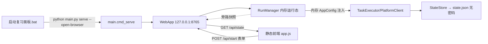
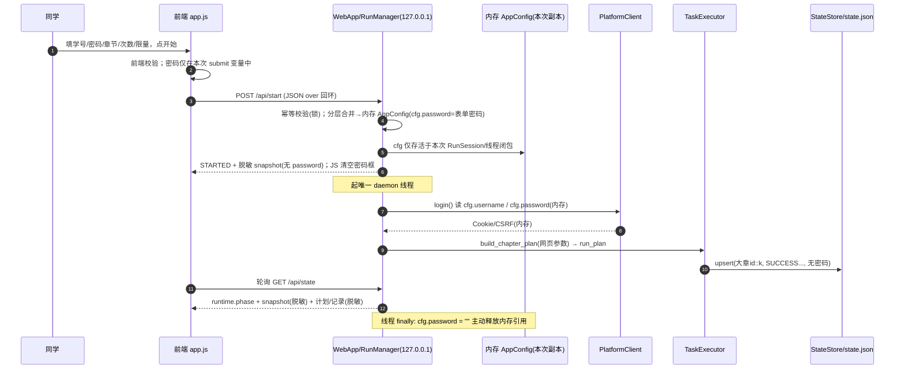
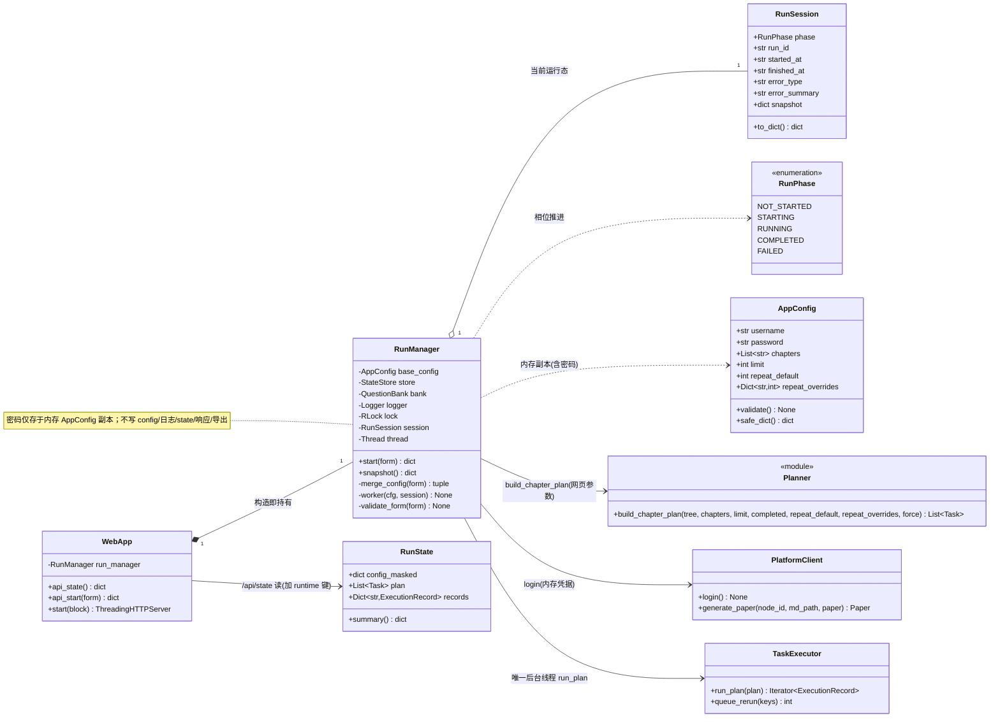
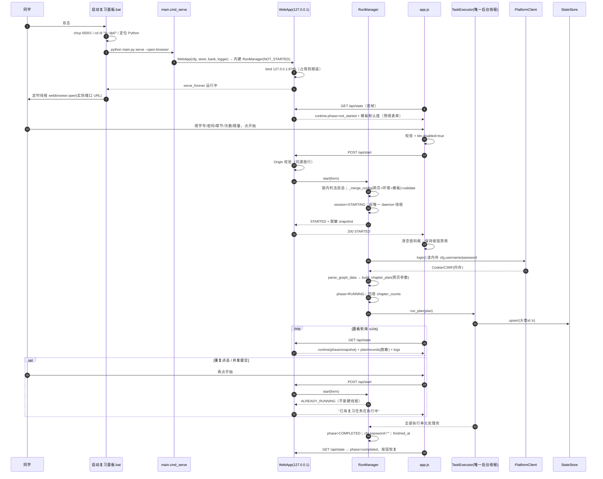

# 章节自测复习助手 — 增量系统设计（design-v3-webstart）

| 项目 | 内容 |
| ---- | ---- |
| 文档类型 | 增量设计与任务分解（在 v2 `design-v2-delta.md` / v1 `design.md` 基础上做最小改动） |
| 版本 | v3-webstart（启动体验增量：双击脚本 → 本机网页填表 → 点按钮启动） |
| 作者 | 架构师（高见远） |
| 上游输入 | `docs/PRD-v3-webstart.md`、`docs/design-v2-delta.md`、`docs/design.md`、`docs/site-verification-2026-11-21.md`（§7 / §7.4）、现有源码、任务 #2 用户拍板决策 |
| 基线 | v2 已交付版本（20 源文件、129 用例全绿，`python -m unittest discover -s tests` 实测 OK） |
| 语言 | 简体中文 |
| 技术栈 | 沿用 v1/v2：**Python 3.10+ 仅标准库 + 原生 HTML/CSS/JS，零第三方包、零前端构建** |
| 合规声明 | 全文无真实账号 / 密码 / Cookie；不调用任何有副作用的真实组卷 / 交卷接口。两红线（允许自动化、允许导出）已解除，产品伦理边界与复习导向文案不变。 |

> **阅读方式**：本文只写"相对 v2 的增量"，未提及部分一律沿用 `design-v2-delta.md` 与 `design.md`。
> **总原则**：**加法式最小改动**——新增 3 个文件、仅改 5 个存量文件；不重写任何 v1/v2 已验证函数，保住 129 用例绿。
> **拍板覆盖关系**：用户最新决策"只提供 Windows 双击脚本"覆盖 PRD 待确认 #1（原建议"命令行为主、脚本 P1"）；本文以双击脚本为首版**唯一推荐入口**。

---

## 1. 变更总览表（v2 → v3）

| # | 设计点 | v2 现状 | v3 变更 | 影响的具体文件 | 改动级别 |
| - | ------ | ------- | ------- | -------------- | -------- |
| 1 | 启动入口 | `python main.py run`（另 config/plan/bank/serve），密码来自环境变量 / 终端无回显 | **Windows 双击 `.bat` → `python main.py serve --open-browser`**；面板起好后网页填表点按钮 | 新增 `启动复习面板.bat`；`main.py`（serve 加 `--open-browser` 与定时开浏览器） | **新增文件 + 极小改动** |
| 2 | 启动控制 | `cmd_run` 起面板时**立即**在 worker 线程建计划并跑 | `serve` 模式**不预跑**；收到 `/api/start` 才由 `RunManager` 建单次执行 | 新增 `runtime.py`；`webapp.py`（容器即建 RunManager，加 `/api/start`） | **新增模块（核心）** |
| 3 | 凭据来源 | 环境变量 `CQA_PASSWORD` / `getpass`，仅 CLI 侧 | 网页密码框 → 本机回环 POST → 内存 AppConfig → 登录 → 执行器；**全链路不落盘** | `runtime.py`、`webapp.py`、`static/index.html`、`static/app.js` | 新增链路 |
| 4 | 配置优先级 | 模板 + 环境变量（网页无路径） | **网页 > 环境变量 > config.json 模板**；网页值仅本次生效、不回写文件 | `runtime.py`（`_merge_config`），复用 `config.py`/`models.py` 现有加载与校验，二者**不改** | 新增函数，无存量改动 |
| 5 | 表单字段 | 无网页表单 | 学号 + 密码 + 8 大章多选/全选 + 每章次数 + 按章覆盖(可选) + 限量；固定参数不进网页 | `static/index.html`、`static/app.js`、`static/app.css`（微调） | 展示层增量 |
| 6 | 运行态 | 无生命周期概念 | `not_started/starting/running/completed/failed` + 脱敏参数快照（含来源标签）供面板展示 | `runtime.py`（`RunPhase`/`RunSession`/`RunManager`）、`webapp.py`（`/api/state` 增 `runtime`）、前端 | 新增 |
| 7 | 幂等 | CLI 一次性起线程，无防连点 | 同进程单 `RunManager` + 锁；活跃期重复 `/api/start` 返回"已有任务在执行中"；前端提交期禁用按钮 | `runtime.py`、`static/app.js` | 新增 |
| 8 | README | 无 | 详细中文 README（10 章，面向零基础） | 新增 `README.md` | 新增文件 |
| 9 | 大章模型 / 规划 / 执行 / 状态 / 导出 | v2 已锁定（8 大章 × k、唯一键 `大章id::k`、`schema_version=2`） | **完全不改**，直接复用 | `planner.py`/`parsers.py`/`executor.py`/`state_store.py`/`models.py`/`exporters.py`/`platform_client.py` 等 | **不改** |

> **依赖包：无新增**。不引入任何第三方库、不增加前端构建；`requirements.txt`、`.gitignore` 保持不动。

---

## 2. 最小改动策略

### 2.1 新增文件（3 个）

| 文件 | 职责 |
| ---- | ---- |
| `runtime.py` | `RunPhase` 枚举、`RunSession` 数据类、`RunManager` 运行态管理器（配置分层合并、参数校验、幂等、单一后台线程、脱敏快照）。 |
| `启动复习面板.bat` | Windows 双击入口：定位 Python → 进项目目录 → 检查 config.json → `main.py serve --open-browser` → 前台运行（错误不闪退）+ `pause`。 |
| `README.md` | 面向零基础同学的中文使用说明（结构见 §5）。 |

### 2.2 必须修改的存量文件（5 个）与改法要点

| 文件 | 改法要点（签名 / 逻辑） | 是否破坏旧接口 / 129 用例 |
| ---- | ---------------------- | ------------------------ |
| `webapp.py` | ① `WebApp.__init__(..., run_manager=None)`：新增可选参；若为 `None` 则用现有 `config/store/bank/logger` 构造 `RunManager`（**这样 `cmd_serve` 与 `cmd_run` 零改动即获得启动能力**）。② `api_state()`：payload 增 `payload["runtime"] = self.run_manager.snapshot()`（脱敏、无密码）。③ 新增 `api_start(self, form: dict) -> dict`：一行委托 `self.run_manager.start(form)`。④ `make_handler.do_POST` 增 `elif path == "/api/start"` 路由 + 轻量同源（Origin）校验；**绝不记录请求体**。⑤ `do_GET` 不动。 | 否（新参带默认值；`/api/state` 只多一个键，旧断言按字段取值不受影响） |
| `main.py` | `build_parser` 给 `serve` 子命令加 `--open-browser`（`action="store_true"`）；`cmd_serve` 在该标志下起一个 daemon 定时线程：轮询 `web.server is not None` 后 `webbrowser.open(f"http://127.0.0.1:{web.actual_port}/")`。**`cmd_run`/`cmd_plan`/`cmd_config`/`cmd_bank` 完全不动**。 | 否（新标志默认 False；`cmd_serve` 原行为不变） |
| `static/index.html` | 在 `<main>` 内、三 `.view` 之前插入 always-visible `<section id="start-panel">`（表单 + 运行态区），不嵌套进任一 view；三视图 DOM 一字不改。 | 否 |
| `static/app.js` | ① 首次 `/api/state` 用 `config_masked` 预填表单（flag 防覆盖用户编辑）；② 渲染 `data.runtime`（状态 + 快照/来源标签）；③ `startRun()`：前端校验 → 禁用按钮 → `POST /api/start` → 反馈 + **清空密码框** → 恢复/保持禁用（依 `runtime.phase`）；④ 全程**不写 localStorage/sessionStorage、不回传密码**。原轮询/三视图函数保留。 | 否 |
| `static/app.css` | 追加 `.start-panel` / `.chapter-grid` / `.source-tag` / `button:disabled` 等少量灰阶样式；不改动既有规则。 | 否 |

### 2.3 明确不改的文件（含理由）

| 文件 | 不改理由 |
| ---- | ------- |
| `config.py`、`models.py` | `load_config/apply_env_overrides/validate_config/masked_view/AppConfig.load/safe_dict` 已完整提供"模板+环境+校验+脱敏"能力；`RunManager` 只做"再叠一层网页值"，无需改动底层。`RunPhase`/`RunSession` 放 `runtime.py`，避免污染领域模型文件。 |
| `planner.py`、`parsers.py` | `build_chapter_plan`/`top_chapter_nodes` 已满足按大章规划；网页值只是换一组入参。8 大章权威清单用于**表单校验/展示数据源**，仍不写死进解析逻辑。 |
| `executor.py`、`platform_client.py` | `login()` 只读 `config.username/password`；`generate_paper` 只认 `node_id`。内存 AppConfig 注入即可，执行器/适配层零改动。 |
| `state_store.py` | `schema_version=2`、`merge_plan`、断点续跑原样复用；运行态/快照**只在内存**，不进 `state.json`，故无 schema 变化。 |
| `exporters.py`、`bank.py`、`logger.py`、`utils.py` | 脱敏与导出逻辑与启动方式正交；日志统一 `mask()`，不加新 sink。 |
| `requirements.txt`、`.gitignore` | 零新依赖；`.gitignore` 已忽略 `config.json/data/logs/exports`，不新增忽略项（`.bat`/`README.md` 需入库）。 |
| `tests/` 既有 12 个测试文件 | 加法式改动预期 129 用例零改动全绿；新增用例另起 `tests/test_v3_webstart.py`。 |

### 2.4 加法式落点说明（保住 129 用例的关键）

- 运行态是**旁路**：`RunManager` 不进入 `executor.run_plan` 与 `StateStore` 的调用链，旧用例对 `TaskExecutor`/`StateStore` 的断言不受影响。
- `cmd_run` 老路径**完全保留**：老同学仍可用命令行；即使 `run` 模式下 WebApp 也自带一个 RunManager（仅 `/api/start` 可用，CLI worker 照旧），二者互不影响。设计上推荐双击脚本用 `serve`。
- `/api/state` 是**加键**而非改结构：旧前端忽略新键、旧测试按字段取值，均不受影响。

---

## 3. 网页启动的架构设计（重点）

### 3.1 分层与控制反转

双击 `.bat` → `main.py serve --open-browser` → `WebApp` 构造时自带 `RunManager` → **只起回环服务、不预跑** → 用户在网页填表点"开始复习" → `POST /api/start` → `RunManager` 分层合并配置、幂等校验 → 起**唯一**后台线程完成"登录 → 规划 → 执行" → 面板轮询 `/api/state` 展示运行态与进度。



### 3.2 新增 API 契约

#### 3.2.1 `POST /api/start`（新增）

**请求（JSON，`Content-Type: application/json`）**

| 字段 | 类型 | 必填 | 含义 / 校验 |
| ---- | ---- | ---- | ----------- |
| `username` | str | 是 | 学号（映射 `username`）；去空白后非空 |
| `password` | str | 是 | 仅本次登录；**只在请求体与内存出现**；前端密码框、不回显 |
| `chapters` | str[] | 是 | 章名或大章节点 id；至少 1 项；`[]` = 8 大章全选；非空项需落在权威清单/合法前缀 |
| `repeat_default` | int | 是 | 每章统一次数，1~99（复用 `REPEAT_LIMIT`） |
| `repeat_overrides` | obj | 否 | `{章名或节点id: 次数}`；值为 1~99 正整数；缺省 `{}` |
| `limit` | int | 是 | 非负整数，0=全量；语义=本次纳入大章数（v2 不变） |
| `confirm_full` | bool | 否 | `limit=0` 或单章次数偏大时前端二次确认标记（承接 PRD 待确认 #5，默认不阻断） |

**响应（统一 `{ok, code, message, ...}`，HTTP 200；校验失败亦 200+code，不吐堆栈）**

```jsonc
// 受理
{"ok": true, "code": "STARTED", "message": "已启动复习，可在总览查看进度。",
 "run_id": "20261121-223500", "snapshot": { /* 见 §3.6 脱敏快照，绝无 password */ }}

// 幂等冲突
{"ok": false, "code": "ALREADY_RUNNING", "message": "已有复习任务在执行中，请等待完成。"}

// 校验失败
{"ok": false, "code": "INVALID_INPUT", "message": "每章次数须为 1~99 的整数。"}

// 同源校验失败（可选加固）
{"ok": false, "code": "FORBIDDEN", "message": "仅允许本机面板提交。"}   // HTTP 403
```

> 登录失败 / 429 / 出分超时等**异步**结果不进 HTTP 响应，由运行态 `phase=FAILED` + 脱敏 `error_summary` 在 `/api/state` 呈现（`_worker` 的 `finally` 兜底）。

#### 3.2.2 `GET /api/state`（扩展，不破坏）

在原 payload 上**只增一个键**：

```jsonc
"runtime": {
  "phase": "running", "phase_text": "执行中", "run_id": "20261121-223500",
  "started_at": "...", "finished_at": "", "error_type": "", "error_summary": "",
  "snapshot": { /* §3.6 */ }
}
```

#### 3.2.3 请求安全（回环加固）

- 地址硬编码 `127.0.0.1`（沿用 `webapp.start`），**禁止** `0.0.0.0`；`config.web.host` 即使被改成 `0.0.0.0` 也在 `start()` 中强制回环（建议加一行断言，见 §8-Q7）。
- `do_POST` 对 `/api/start` 做轻量 Origin 校验：仅放行无 Origin（脚本/测试直调）或 `http://127.0.0.1:*`/`http://localhost:*`；拦住外部网页对本机端口的 CSRF 提交。
- `log_message` 沿用"不输出请求日志"，**Req body 与密码永不进日志**。

### 3.3 凭据内存传递链路与"不落盘"论证



**全链路"密码不出本机 / 不落盘"逐 sink 论证：**

| Sink | 结论 | 依据 / 保障 |
| ---- | ---- | ----------- |
| `config.json` | **不写** | 网页启动路径**从不调用** `save()`；`save_config`/`AppConfig.save` 本就强制 `pop("password")`（存量逻辑）。 |
| 日志文件 `logs/app.log` | **不写** | 登录异常经 `mask()`（敏感键→`***`）；`webapp.log_message` 空实现、`do_POST` 不记录 body；`_worker` 只记 `mask(str(exc))`；错误摘要不含密码。 |
| `state.json` | **不写** | 运行态/快照只在内存；`RunState.config_masked` 来自 `cfg.safe_dict()`→`masked_view`→`password:"***"`；记录只含唯一键/状态/分数。 |
| `/api/state` 状态响应 | **不返回** | `api_state` 只返回 `RunState.to_dict()` + `runtime`；`snapshot` 由 `_merge_config` 显式白名单构造，**字段清单根本不含 password**。 |
| 导出物 CSV / 题库 HTML·MD·JSON | **不带出** | `exporters` 统一 `masked_view`；记录/题目结构无密码字段。 |
| 前端存储 | **不留存** | 密码框 `type="password" autocomplete="off"`；不写 `localStorage/sessionStorage`；不随轮询回传；提交成功后立即 `input.value = ""`。 |
| 内联脚本 / DOM | **不回显** | 快照渲染白名单字段，无密码；不把密码写入 `data-*`、文本节点或 `window` 全局。 |
| 进程内存 | **仅本次** | 密码只存于本次 `cfg.password` 副本与线程闭包；互斥锁保证单线程；`finally` 置空，进程退出即消失。重启后需重新在网页填（PRD 待确认 #4）。 |

> 综合 §3.2.3 回环监听，满足 FR-7.2 / FR-7.3：**凭据不出本机**。

### 3.4 执行器启动与幂等

**`RunManager` 内部状态（内存、单实例、受 `threading.RLock` 保护）：**

```python
class RunManager:
    def __init__(self, base_config, store, bank, logger):
        self.base_config = copy.deepcopy(base_config)   # 模板+环境（启动 serve 时的配置）
        self.store, self.bank, self.logger = store, bank, logger
        self._lock = threading.RLock()
        self._session = RunSession(phase=RunPhase.NOT_STARTED)  # 当前运行态
        self._thread = None                            # 至多一个执行线程

    def start(self, form: dict) -> dict: ...
    def snapshot(self) -> dict: ...                    # 返回脱敏副本
    # private
    def _merge_config(self, form) -> tuple: ...        # 返回 (cfg, source_tagged_snapshot)
    def _worker(self, cfg, session) -> None: ...
```

**幂等与线程生命周期（`start()` 伪码）：**

```text
with lock:
    if session.phase in (STARTING, RUNNING):
        return {ok:False, code:"ALREADY_RUNNING", ...}        # 不新建线程
    try:
        cfg, snapshot = _merge_config(form)                    # 分层合并 + 校验(可读错误)
    except ValueError as e:
        return {ok:False, code:"INVALID_INPUT", message:str(e)}
    session = RunSession(phase=STARTING, run_id=ts, started_at=now,
                         snapshot=snapshot)                    # 原子替换当前会话
    self._session = session
    self._thread = threading.Thread(target=self._worker,
                                    args=(cfg, session), name="cqa-web-exec", daemon=True)
    self._thread.start()
    return {ok:True, code:"STARTED", run_id=ts, snapshot=snapshot_masked}
```

- **判定依据**：只看是否存在活跃运行态（STARTING/RUNNING），**不按参数内容**（FR-8.5）。
- **相位推进**：`STARTING`（建 cfg/线程，worker 登录+解析+建计划）→ `RUNNING`（`run_plan` 前）→ `COMPLETED` / `FAILED`（`finally` 统一收口，写 `finished_at` 并释放 `cfg.password`）。
- **前端防连点**：`startRun()` 一进入就 `btn.disabled = true`，`POST` 成功收到 `ALREADY_RUNNING` 也保持禁用直到 `runtime.phase ∉ {starting,running}` 再恢复；轮询里按 phase 同步禁用态。
- **P1（首版不做）**：停止当前任务 / 排队重启，提示"请等待当前任务完成"（PRD FR-8.5-P1）。
- **同进程单执行**：全局仅一个 `cqa-web-exec` 线程，天然满足"禁止并发请求同一接口"与单请求间隔（沿用 v1 §1.4）。

### 3.5 配置优先级落地（网页 > 环境变量 > 模板）

`_merge_config(form)` 采用**逐层覆盖 + 显式来源标签**，绝不回写文件：

```text
base = deepcopy(self.base_config)     # 该对象在 cmd_serve 时已由 AppConfig.load() 完成 "config.json 模板 + 环境变量"
                                       # 且 require_password=False → 无 getpass 阻塞（双击脚本必须无终端交互）
cfg = deepcopy(base)
# 网页层（最高优先级）— 仅这 6 个可覆盖字段
if form.username:        cfg.username = form.username
if form.password:        cfg.password = form.password        # 只进内存
if form.chapters 是列表:  cfg.chapters = form.chapters
cfg.repeat_default = form.repeat_default
cfg.repeat_overrides = form.repeat_overrides
cfg.limit = form.limit
cfg.validate()                                               # 复用现有校验（含内存密码）
```

| 参数 | 模板来源 | 环境变量 | 网页 | 是否回写 config.json |
| ---- | -------- | -------- | ---- | -------------------- |
| 学号 `username` | ✓ | `CQA_USERNAME` | **✓（最高）** | 否 |
| 密码 `password` | ✗（永不入文件） | `CQA_PASSWORD`（可被网页覆盖） | **✓（最高）** | 否 |
| 章节 `chapters` | ✓ | `CQA_CHAPTERS` | **✓** | 否 |
| 每章次数 `repeat_default` | ✓ | `CQA_REPEAT_DEFAULT` | **✓** | 否 |
| 按章覆盖 `repeat_overrides` | ✓ | ✗（对象不进环境变量，沿用 v2 Q6） | **✓** | 否 |
| 限量 `limit` | ✓ | `CQA_LIMIT` | **✓** | 否 |
| 站点/模型/组卷/超时重试/目录/web | ✓ | ✓（现有 `_ENV_MAP`） | ✗ **不进网页** | 否 |

- **不回写保证**：整条 v3 路径没有任何 `cfg.save()` / `save_config()` 调用；网页值只活在 `cfg` 内存副本与快照里。
- **回落保证**：未填写/缺省字段留在 `base`（模板+环境），与 PRD "未填字段回落模板默认"一致。
- **来源标签**：`_merge_config` 比较网页值与 `base` 值生成 `source ∈ {template, env, web}`（展示为 模板默认 / 环境变量 / 网页修改），写入快照；每章次数来源继续复用 v2 `repeat_source ∈ {default, override}`（展示 默认 M / 覆盖 M）。

### 3.6 运行态与脱敏参数快照

**`RunPhase`（放 `runtime.py`）：**

```python
class RunPhase(str, Enum):
    NOT_STARTED = "not_started"   # 未启动：serve 起好、尚无提交
    STARTING    = "starting"      # 启动中：合并配置/登录/建计划
    RUNNING     = "running"       # 执行中：run_plan 正在跑
    COMPLETED   = "completed"     # 已完成：本轮全部处理
    FAILED      = "failed"        # 失败：启动/登录/规划阶段中止（执行单元失败仍记各自 FAILED）
```

**`RunSession.to_dict()` 白名单（绝无 password）：**

```jsonc
{
  "phase": "running", "phase_text": "执行中", "run_id": "20261121-223500",
  "started_at": "2026-11-21T22:35:00+08:00", "finished_at": "",
  "error_type": "", "error_summary": "",
  "snapshot": {
    "username":      {"value": "2021xxxx", "source": "web"},
    "chapters":      {"value": ["2_测序", "3_组装"], "source": "web"},
    "repeat_default":{"value": 3, "source": "template"},
    "repeat_overrides":{"value": {"2_测序": 5}, "source": "web"},
    "limit":         {"value": 10, "source": "web"},
    "chapter_counts":[                                  // worker 建计划后回填，来自 build_chapter_plan
      {"chapter":"2_测序", "node_id":"20260907180845_0005", "count":5, "source":"override"},
      {"chapter":"3_组装", "node_id":"20260907180845_0008", "count":3, "source":"default"}
    ]
  }
}
```

- 快照在 `STARTING` 阶段先填表单值（无 `chapter_counts`），worker 建完计划后回填 `chapter_counts`（FR-6.5 / FR-8.1 来源展示）。
- 运行态**只在内存**：进程重启即回 `NOT_STARTED`；任务进度（plan/records）仍在 `state.json`，二者解耦（迁移见 §6）。

### 3.7 类图（增量，Mermaid）



### 3.8 完整时序图（双击脚本 → 网页启动 → 幂等 → 进度）



---

## 4. 启动脚本设计（Windows 双击 `.bat`）

### 4.1 定位与调用入口

- **文件**：`启动复习面板.bat`（项目根目录，随仓库入库）。
- **调用 CLI**：`python main.py serve --open-browser`（`serve` = 只起面板不预跑；`--open-browser` = v3 新增标志，由 Python 侧用 `webbrowser` 打开**实际端口**，规避端口顺延导致的 URL 不准）。
- **为何不用 `run`**：`run` 会在启动时用环境变量/`getpass` 取密码并立即开跑，双击场景无终端交互会卡住；`serve` 用 `require_password=False`，密码改由网页提交。

### 4.2 脚本内容方案（保存时建议 ANSI/GBK 编码以正常显示中文；若乱码可将 echo 改英文）

```bat
@echo off
chcp 65001 >nul
setlocal EnableExtensions
cd /d "%~dp0"
title 章节自测复习助手 - 本机面板（请保持本窗口开启）

echo ============================================
echo  章节自测复习助手 · 本机面板
echo  仅在本机运行（127.0.0.1），账号密码只在网页填写
echo ============================================
echo.

rem --- 1) 定位 Python 解释器：优先 py 启动器，其次 PATH 中的 python ---
set "PY="
where py >nul 2>&1
if %errorlevel%==0 (
  py -3 -c "import sys;assert sys.version_info>=(3,10)" >nul 2>&1
  if not errorlevel 1 set "PY=py -3"
)
if not defined PY (
  where python >nul 2>&1
  if %errorlevel%==0 (
    python -c "import sys;assert sys.version_info>=(3,10)" >nul 2>&1
    if not errorlevel 1 set "PY=python"
  )
)
if not defined PY (
  echo [错误] 未找到 Python 3.10+。请安装并在安装时勾选 "Add Python to PATH"。
  echo 安装后重新双击本脚本。
  echo.
  pause
  exit /b 1
)

rem --- 2) 首次使用：由模板生成 config.json（不含任何真实凭据）---
if not exist "config.json" (
  if exist "config.example.json" (
    copy /y "config.example.json" "config.json" >nul
    echo [提示] 已由 config.example.json 生成 config.json。
    echo [提示] 请用记事本打开 config.json，填好站点地址等固定参数后保存。
    echo [提示] 密码不要写进文件，稍后在网页里填写。
    echo.
  ) else (
    echo [错误] 缺少 config.example.json，请重新完整 clone 项目。
    pause
    exit /b 1
  )
)

rem --- 3) 前台启动面板；--open-browser 由 Python 打开实际端口 ---
echo 正在启动本机面板，浏览器将自动打开；若未自动打开请看下方的地址。
echo 面板只在本机可访问；关闭本窗口会停止面板，请先完成复习或保留窗口。
echo.
%PY% main.py serve --open-browser

rem --- 4) 任何异常退出都停在窗口里，避免闪退看不清原因 ---
echo.
echo 面板已停止。若上方出现错误信息，请截图反馈。
echo 若提示端口占用，程序已自动顺延到 8765 之后的端口，请以窗口显示的地址为准。
pause
```

### 4.3 健壮性要点对照

| 要求 | 脚本 / 代码保障 |
| ---- | --------------- |
| 中文路径 | `cd /d "%~dp0"` 用引号，支持含空格/中文的项目路径；`chcp 65001` 统一 UTF-8 页。 |
| Python 定位 | 先 `py -3`（校验版本 ≥3.10），再 `python`；都找不到给可读错误 + `pause`。 |
| 端口占用 | `WebApp.start()` 现有"8765 起顺延最多 20 个端口"逻辑；`--open-browser` 读 `web.actual_port` 打开**真实地址**；脚本末尾提示以窗口地址为准。 |
| 错误不闪退 | 服务**前台运行**，未用 `start` 拆窗；`if not defined PY` 与末尾均有 `pause`；异常栈留在窗口。 |
| 首次配置 | 自动从 `config.example.json` 复制 `config.json`，提示填固定参数、密码不写文件。 |
| 自动开浏览器 | `main.cmd_serve --open-browser` 起 daemon 线程轮询 `web.server` 就绪后 `webbrowser.open(实际 URL)`（标准库，无新依赖）。 |
| 凭据安全 | 脚本不接收/不显示密码；密码只在网页 POST；`config.json` 由无密码模板生成。 |

---

## 5. README 结构（详细中文，面向零基础同学）

> 严格按 PRD §5 大纲 10 章组织；**双击脚本是唯一推荐主路径**，命令行仅在 FAQ/进阶处提及，不作为主流程。

| 章 | 标题 | 每章要点 |
| -- | ---- | -------- |
| 1 | 项目简介与用途边界 | 一句话定义"章节自测复习助手"；**仅个人课程自测与复习**；不用于多账号/班级共用、不绕过监考、不伪造成绩；复习导向用语。 |
| 2 | 环境与前置要求 | Windows 10/11；Python **3.10+**（给出 python.org 下载要点，勾选 Add Python to PATH）；现代桌面浏览器（Edge/Chrome）；`pip install -r requirements.txt`（说明"当前无第三方包，此步通常无需安装"）；运行机需与目标站点同网络或已接 VPN；**无需 Node / npm / 前端构建**。 |
| 3 | 获取项目 | `git clone <仓库地址>` → 进入项目目录；图示目录结构（重点标出 `启动复习面板.bat`、`config.example.json`）；**切勿把真实凭据提交进仓库**。 |
| 4 | 配置模板 | 用记事本把 `config.example.json` 另存为 `config.json`；填 `base_url` 等**固定参数**（站点地址、模型、组卷、超时重试、目录、web 端口）；说明"**密码不要写进文件**"；`chapters/repeat_default/limit` 可留模板默认（网页会覆盖）；可选环境变量 `CQA_PASSWORD` 的作用（命令行路径才用，双击网页路径无需设置）。 |
| 5 | 网页启动步骤（主路径） | **双击 `启动复习面板.bat`** → 保持黑色窗口开启 → 浏览器自动打开 `http://127.0.0.1:8765/`（占用则看窗口实际地址）→ 在"复习启动"表单填学号/密码、勾选章节（可全选）、设每章次数与限量 → 点"开始复习" → 在同页看进度；强调"**面板只在本机、密码只在网页填、关掉浏览器页面不中断后台执行（但别关黑窗口）**"。 |
| 6 | 表单填写说明 | 逐字段含义；章节勾选与"全选/全不选"；每章次数（`repeat_default`）vs 按章覆盖（`repeat_overrides`，可选，给某章单独设次数）；**限量 = 本次纳入大章数，0 = 全量**；来源标签"模板默认/环境变量/网页修改"与"默认 M / 覆盖 M"含义；空学号/密码、越界次数的可读提示。 |
| 7 | 查看进度与结果 | 三视图（总览 / 复习记录 / 复习题库）用途；运行态（未启动/启动中/执行中/已完成/失败）与本次参数快照（脱敏）；≤10s 自动刷新与日志尾部；导出 CSV / 题库三格式；失败项查看摘要与"重新执行"；断点续跑（已 SUCCESS 的不重复组卷）。 |
| 8 | 常见问题（FAQ） | 面板打不开/需在本机；**端口占用看黑窗口实际地址**；首次双击没开浏览器就手动访问；登录失败（核对学号密码、站点地址、网络/VPN）；429 限流自动重试；出分慢/超时记失败；config 损坏的可读错误；**重复点击无反应=已有任务执行中**；关页面是否中断（不中断）；题库导出位置 `exports/`；换人使用先清理 `data/`；进程重启需重新在网页填密码。 |
| 9 | 合规边界与伦理 | 用途限定、不分发不商用、不伪造成绩、不绕过监考/身份验证/防作弊；"先自测、后看解析"；复习导向用语；数据仅存本机。 |
| 10 | GitHub 上传注意事项 | `.gitignore` 已忽略 `config.json`/`data/`/`logs/`/`exports/`；上传前确认无真实账号/密码/Cookie 入库；`config.example.json` 仅占位符；README 示例无真实凭据；**密码只在网页输入、不落盘**；`.bat` 与 `README.md` 可正常入库。 |

---

## 6. 迁移 / 兼容策略

| 对象 | v2 现状 | v3 处置（明确结论） | 理由 |
| ---- | ------- | ----------------- | ---- |
| `state.json`（`schema_version=2`，键=`大章id::k`） | 含 plan/records/summary | **完全兼容、零改动**：网页启动仍走 `merge_plan`/`run_plan`/`upsert`，格式不变；运行态与快照只在内存，不写该文件 | 无新字段，无 schema 升级 |
| `config.json`（模板） | 含 `base_url` + `repeat_default/overrides` 等 | **完全兼容、不回写**：`serve` 用 `require_password=False` 读取；网页值只在内存副本，任何路径都不调用 `save()` | "网页>环境>模板"的回落依赖模板存在 |
| CLI 子命令 `config/plan/run/bank/serve` | 可用 | **保留**；`serve` 仅新增可选 `--open-browser`；`run` 一字不改 | 老同学与自动化用例不受影响 |
| 129 个既有用例 | 全绿 | **预期零改动全绿**（新文件旁路、新键追加、新参带默认值） | 加法式改动 |
| 旧 `cmd_run` worker 与 `RunManager` 并存 | — | `run` 模式 WebApp 也会内建 RunManager，但 CLI worker 照常执行；二者单例互不影响；**推荐双击脚本走 `serve`** | 避免过度耦合 |
| 数据目录 `data/ logs/ exports/` | — | 不删除、不迁移；换人使用由 README 指引手动清理 `data/`（单机单用户，PRD 待确认 #6） | 尊重用户数据 |

> 用户侧提示：升级后首次双击即可用；进程重启后运行态回到"未启动"，需在网页重新填学号密码（任务进度仍在）。

---

## 7. 对 QA 的测试影响

### 7.1 保持不动的用例资产

- 既有 12 个测试文件、129 用例**零改动全绿**（工程师完成后先跑 `python -m unittest discover -s tests` 确认基线）。
- v2 大章模型（8 章清单、唯一键 `大章id::k`、按章覆盖、断点续跑）、FR-3/4/5、三视图、脱敏规范、复习导向文案全部沿用。

### 7.2 新增用例（`tests/test_v3_webstart.py`，全部用 Fake transport/chat，**禁止**真实消耗接口）

| # | 用例 | 断言要点 |
| - | ---- | ------- |
| N1 | 网页启动闭环 | `POST /api/start` 合法表单 → `code=STARTED`，`RunManager._thread` 恰好 1 个 daemon 线程；相位 STARTING→RUNNING→COMPLETED（注入假 client/executor 控制时序）。 |
| N2 | 凭据不落盘（核心） | 同一次启动后断言：磁盘 `config.json` 内容不含密码；`logs/app.log` 不含；`data/state.json` 不含；`GET /api/state` 完整 JSON 串不含；`api_export(csv/html/md/json)` 字节中不含；前端模板/快照中无 `password` 键。 |
| N3 | 幂等 | 相位 RUNNING 时并发两次 `/api/start` → 第二次 `ALREADY_RUNNING`；`threading.active_count()` 中 `cqa-web-exec` 始终 1。 |
| N4 | 参数即时生效 | 假 `PlatformClient.login` 收到网页学号/密码；`build_chapter_plan` 收到网页章节/次数/覆盖/限量；执行单元数 = Σ每章次数、`limit` 按大章数。 |
| N5 | 配置优先级 | 同一字段分别只设模板 / 只设环境变量 / 只设网页值，断言网页 > 环境 > 模板；网页启动后 `config.json` 字节不变（不回写）。 |
| N6 | 快照与来源标签 | `/api/state.runtime.snapshot` 含 `username/chapters/repeat_default/repeat_overrides/limit/chapter_counts` 及 `source`；`chapter_counts` 含 `count`/`source(default|override)`；整段无密码。 |
| N7 | 运行态展示 | 五相位 `phase_text` 正确；`FAILED` 时 `error_type/error_summary` 有值且已脱敏。 |
| N8 | 回环监听 | `WebApp.start` 绑定地址断言为 `127.0.0.1`（非 `0.0.0.0`）；篡改 `config.web.host=0.0.0.0` 时仍回环（见 §8-Q7 加固）。 |
| N9 | 参数校验 | 空学号 / 空密码 / 非法章节 / 次数 0 或 100 / 负数 limit → `INVALID_INPUT`、可读 message、无堆栈、不新建线程。 |
| N10 | 启动脚本存在性 | `启动复习面板.bat` 存在且含 `cd /d "%~dp0"`、`main.py serve`、`--open-browser`、`pause`、`chcp`；不含 `0.0.0.0`；不含明文账号密码。 |
| N11 | README 与合规 | `README.md` 10 章标题齐全；示例无真实凭据；无"刷分"措辞；双击脚本为主路径。 |
| N12 | 前端安全静态检查 | `app.js` 无 `localStorage/sessionStorage` 写密码、`/api/state` 轮询体不含 password、`index.html` 密码框为 `type="password"`、提交成功有清空逻辑、`btn.disabled` 防连点。 |

> 新增用例与旧用例同样遵守"测试红线"：fixtures 用虚构域名/会话，只验证契约与状态流转。

---

## 8. 待明确事项（技术侧，均有不阻塞开工的默认处置）

| # | 事项 | 建议默认处置 | 影响 |
| - | ---- | ------------ | ---- |
| Q1 | 密码框是否需要预填 | **永不预填**，每次启动为空（PRD 待确认 #4） | FR-7.3 |
| Q2 | 来源标签粒度 | 用 `{template, env, web}` 三值，展示"模板默认/环境变量/网页修改"；比 PRD 两值更精确且兼容 | FR-6.5 |
| Q3 | 按章覆盖网页是否可编辑 | **首版可编辑**（团队拍板"按章覆盖(可选)"入表单）；若工期紧可降级为只读展示、编辑留 config.json（PRD 待确认 #3） | FR-8.1 |
| Q4 | 限量=0 / 大次数二次确认 | 前端 `confirm()` 提示 + 提交 `confirm_full`；后端不强制校验该标记（避免阻断自动化用例） | FR-8.3 |
| Q5 | 多同学共用一台机器的数据隔离 | 首版**单机单用户**，不做账号体系；README 指引换人前清理 `data/`（PRD 待确认 #6） | FR-6.5 |
| Q6 | 学号是否在快照明文展示 | 学号非凭据，默认明文展示（与现有 `config_masked.username` 一致）；如担心隐私可中间位打码 | FR-6.5 |
| Q7 | `config.web.host` 被改成 `0.0.0.0` | 建议 `WebApp.start()` 增一行断言：host 非 `127.0.0.1` 时强制回环并告警（把拍板 1 落到代码级），QA N8 覆盖 | FR-7.2 |
| Q8 | `.bat` 中文编码 | 保存为 ANSI(GBK) 显示正常；若用 UTF-8 保存，脚本首行 `chcp 65001` 已配合；极端乱码时把 echo 改英文 | 启动脚本 |
| Q9 | 运行态是否持久化 | 默认**不持久化**（仅内存），进程重启回 `NOT_STARTED`；任务进度仍持久化在 `state.json` | FR-6.5 / 迁移 |
| Q10 | 外部网页 CSRF 提交到本机端口 | 默认加轻量 Origin 校验（§3.2.3），不影响同源 fetch 与直调测试 | 安全加固 |

> 以上均有"不阻塞开工"的默认处置；若主理人/用户拍板不同，仅局部调整 `runtime.py` / `webapp.py` / 前端，不涉及架构重构。

---

## 9. 共享知识增量（对 design.md §7 / design-v2 §9 的补充）

1. **网页启动只走回环**：`127.0.0.1` 硬约束，禁止 `0.0.0.0`、禁止集中部署；凭据不出本机。
2. **密码唯一合法落点**：仅存于内存 `AppConfig.password` 副本 + 请求体；不写 config.json / 日志 / state.json / 状态响应 / 导出物；前端不回显、不写本地存储、不随轮询回传；线程 `finally` 置空。
3. **配置优先级**：网页 > 环境变量 > config.json 模板；网页值只对本次执行生效、任何路径都不回写文件；固定参数（站点/模型/组卷/超时/目录/web）不进网页。
4. **运行态与任务态分离**：运行态（五相位 + 脱敏快照）在内存、进程级；任务态（plan/records）在 `state.json`、跨进程持久化。二者通过 `RunManager` 旁路关联。
5. **幂等判据**：只看是否有活跃运行态（STARTING/RUNNING），不看参数；单进程单 `cqa-web-exec` 线程；前端提交期禁用按钮。
6. **大章模型不变**：8 大章权威清单（§7.4）、唯一键 `大章id::k`、`limit`=大章数、`repeat_default/repeat_overrides`、断点续跑全部沿用；网页值只是新入参。
7. **来源标签**：字段级 `{template,env,web}` + 章次级 `repeat_source ∈ {default,override}`；文案"模板默认/环境变量/网页修改""默认 M / 覆盖 M"。
8. **测试红线不变**：任何用例不得调用真实有副作用接口；fixtures 用虚构域名与会话；以 129 基线为零回归门槛。

---

> 本文是工程师（任务 #3）实现网页启动 + 中文 README 的唯一增量技术依据，也是 QA（任务 #4）新增用例的依据。任何接口契约变更先改 `runtime.py` / `webapp.py`，再同步本文 §3 与 §9。
