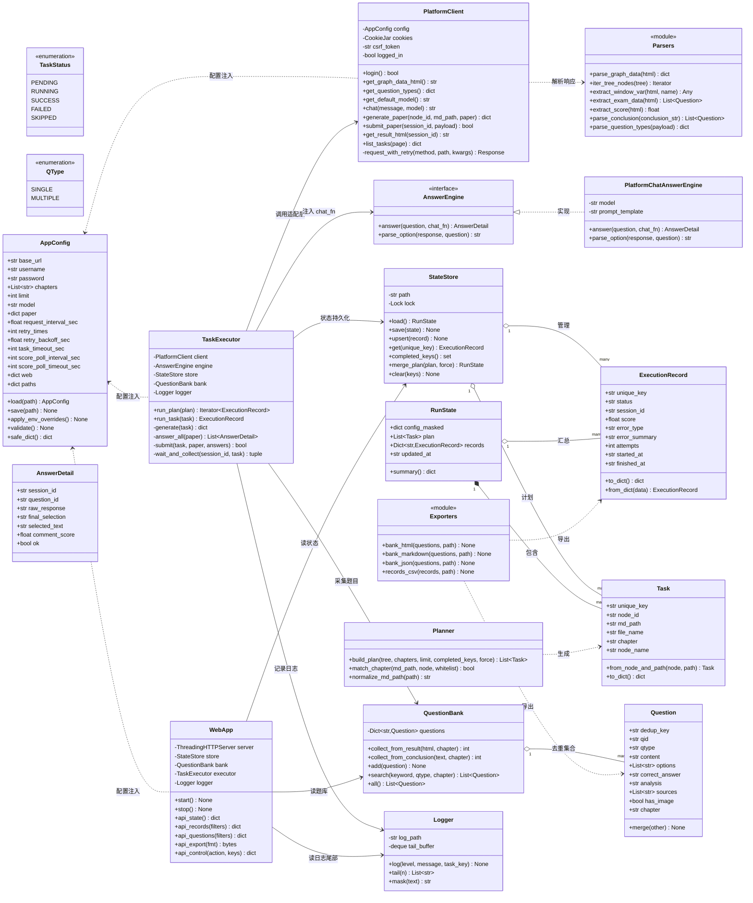
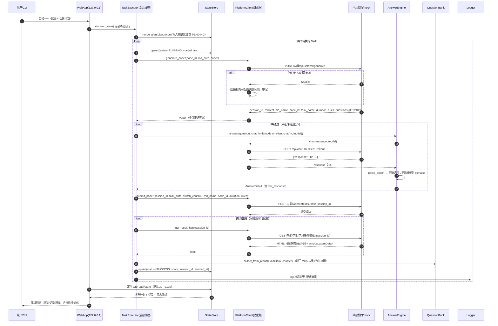
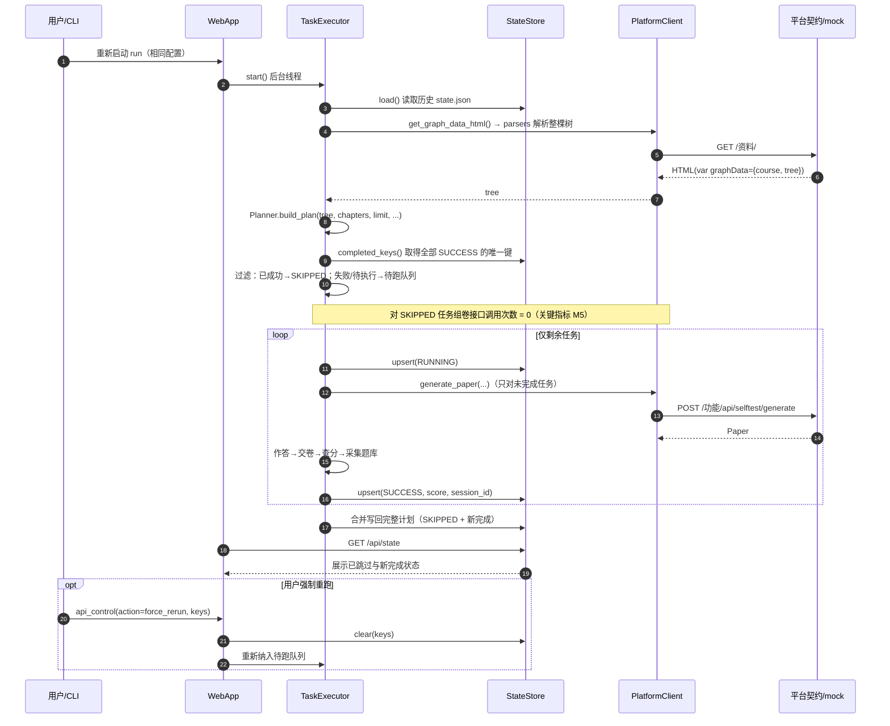
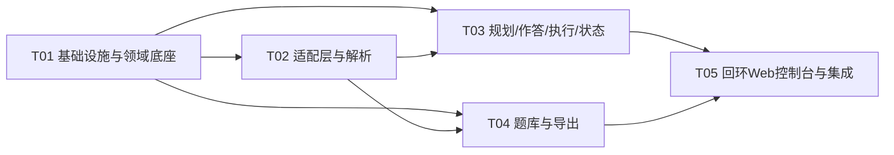

# 章节自测复习助手 — 系统设计与任务分解（design.md）

| 项目 | 内容 |
| ---- | ---- |
| 文档类型 | 系统设计 + 实现任务分解（工程师批量编码依据） |
| 版本 | v1.0（架构定稿，输入：PRD v1.1 确认版 + PRD v1.0 草稿附录 A + 站点核验记录） |
| 作者 | 架构师（高见远） |
| 上游输入 | `docs/PRD-confirmed.md`、`docs/PRD-v1.0-draft.md`、`docs/site-verification-2026-11-21.md` |
| 语言 | 简体中文 |
| 合规声明 | 全文不含任何真实账号、密码、Cookie 或会话凭据；站点接口仅按契约与本地 mock 设计，不在设计/测试阶段调用真实组卷/交卷接口 |

---

## 1. 实现方案与框架选型

### 1.1 核心技术挑战

| # | 挑战 | 来源 | 设计应对 |
| - | ---- | ---- | ------- |
| C1 | **796 个 `.md` 文件**散布在树各层，`graphData.tree` 同时兼容对象与数组 | 核验 §3/§4 | 递归泛型遍历器（不假定层级与字段名），`files` 收集与节点归属分离 |
| C2 | 文件路径可能重名，单用路径作键会在断点续跑时错判 | 核验提示 2 | 唯一键 = `节点id :: 归一化文件路径`，全链路贯穿 |
| C3 | 平台 429 限流、评阅 10–90s 不确定、单套最坏 180s | 附录 A.6/A.7/A.11 | 单工作线程 + 全局请求间隔 + 指数退避重试 + 单任务硬超时，超时记失败不无限等待 |
| C4 | 面板执行期间持续可用、刷新 ≤10s、展示完整计划含待执行 | FR-6.4 | `ThreadingHTTPServer` 提供静态页 + API；执行器在独立后台线程；状态落盘为原子 JSON，面板轮询读取 |
| C5 | 作答逻辑需与平台 HTTP 解耦、结果必须可解析为明确选项 | FR-3.2 | `AnswerEngine` 以 `chat_fn` 可调用对象注入，解析失败即失败并保留原始返回 |
| C6 | 凭据安全 + 仅回环监听 + 导出物脱敏 | FR-7 | 密码走 `getpass`/环境变量，仅内存持有；配置模板占位；服务绑定 `127.0.0.1`；统一日志脱敏函数 |
| C7 | 用户时间有限、可借助 AI 助手运行，不能引入复杂构建环境 | PRD §6 | **零第三方依赖、零前端构建**：Python 标准库 + 原生 HTML/CSS/JS |

### 1.2 技术栈决策总表

| 层次 | 选型 | 理由（如何满足硬约束） |
| ---- | ---- | --------------------- |
| 运行时 | **Python 3.10+（仅标准库）** | 跨平台（Win/macOS/Linux）、用户可 `python main.py` 一键启动；`http.server` / `urllib` / `json` / `re` / `csv` / `hashlib` / `threading` 覆盖全部需求，**无需 pip 安装任何包**，直接满足"无需复杂构建环境" |
| HTTP 客户端 | `urllib.request` + `http.cookiejar` | 标准库即可维持 `session` / `csrf_token` Cookie 会话并注入 `X-CSRF-Token` 头；不需要 requests |
| Web 控制台服务端 | `http.server.ThreadingHTTPServer` | 标准库、单文件即可运行；多线程保证"执行中面板仍可点"；显式绑定 `127.0.0.1` 满足 FR-7.2 |
| 前端 | **原生 HTML + CSS + JavaScript（无框架、无打包）** | 静态文件由上述服务直出；`fetch` 轮询 `/api/state`（默认 3s，≤10s）；无 npm、无 Vite、无 React/MUI，浏览器直接打开，符合"零构建" |
| 持久化 | **原子 JSON 文件**（`data/state.json`、`data/config.json`） | 标准库 `json` + `os.replace` 临时文件原子替换，避免面板读半截；无需数据库与 ORM |
| 日志 | `logging` + 内存环形缓冲 | 文件滚动追加 + `tail(n)` 供面板读取，统一脱敏 |
| 测试 | `unittest`（标准库）+ 本地假数据/mock | 核心逻辑（遍历、唯一键、去重、状态机、重试、导出）与网络解耦，可离线单测；不调用真实平台 |

> **明确否决的方案**：React + Vite + MUI + Tailwind（需 Node 与 npm install、构建步骤，违背零构建与用户时间有限约束）；Flask/FastAPI（引入第三方依赖，标准库已足够）；SQLite（增加 ORM/迁移心智负担，JSON 已满足单机单用户规模）。

### 1.3 架构模式

**分层架构 + 适配器（Ports & Adapters）**：

```
┌─ 入口层   main.py（CLI：config / plan / run / bank / serve）
├─ 控制层   webapp.py（回环 Web 服务 + 后台执行线程 + API）
├─ 服务层   planner / executor / answer_engine / state_store / bank / exporters / logger
├─ 适配层   platform_client.py（唯一知道站点 URL 与 Cookie/CSRF 的模块）
├─ 解析层   parsers.py（纯函数：HTML/JSON → 领域对象，不触网）
└─ 领域层   models.py（dataclass + 枚举）+ config.py + utils.py
```

依赖方向单向向下；**只有 `platform_client.py` 允许发起网络请求**，接口变更只改适配层与 `parsers.py`，不触及规划/执行/UI。

### 1.4 执行模型（面板可用性的关键）

- `main.py run` 启动 `ThreadingHTTPServer`（回环）**并**在一个后台守护线程中运行 `TaskExecutor`。二者同进程、互不阻塞。
- 执行器每完成一次状态变更即 `StateStore.upsert()` → 原子写 `data/state.json`。
- 面板 `setInterval` 每 3 秒 `GET /api/state`，服务端直接读磁盘文件返回；浏览器关闭不影响后台线程。
- 全局仅 **1 个执行线程**，所有平台请求串行发出，天然满足"禁止并发请求同一接口"；请求之间插入可配置 `request_interval_sec`。

---

## 2. 文件列表及相对路径

> 全部相对 `chapter-quiz-assistant/` 根目录；目标 **20 个源文件**，模块解耦。

| # | 文件（相对路径） | 职责（一句话） |
| - | --------------- | ------------- |
| 1 | `main.py` | CLI 入口与装配：`config/plan/run/bank/serve` 子命令，启动回环服务与后台执行线程。 |
| 2 | `config.py` | 配置加载/保存、环境变量覆盖、必填与范围校验、`getpass` 无回显输入、脱敏视图。 |
| 3 | `models.py` | 领域数据类与枚举：`AppConfig/Task/ExecutionRecord/Question/AnswerDetail/RunState/TaskStatus/QType`。 |
| 4 | `utils.py` | 跨模块纯工具：唯一键生成、路径归一化、MD5、原子 JSON 读写、退避计算、日志脱敏、时间格式化。 |
| 5 | `logger.py` | 文件日志 + 内存尾部缓冲，统一脱敏后输出，`tail(n)` 供面板读取。 |
| 6 | `platform_client.py` | **平台适配层唯一网络出口**：登录/Cookie/CSRF、组卷/交卷/查分/问答/任务列表等全部接口与 429 重试。 |
| 7 | `parsers.py` | 纯解析函数：`graphData` 提取与递归遍历、页面变量提取、分数/解析/`conclusion` 解析，不触网。 |
| 8 | `planner.py` | 任务规划：树节点→任务全集、章节筛选（编号+名称前缀）、默认限量 10、强制重跑标记。 |
| 9 | `answer_engine.py` | 作答引擎接口 + 平台问答实现：通过注入的 `chat_fn` 作答，解析为明确选项，失败保留原始返回。 |
| 10 | `executor.py` | 单任务/计划执行器：组卷→作答→交卷→轮询出分→落库→题库采集，超时与重试、失败隔离、状态机。 |
| 11 | `state_store.py` | 执行记录持久化：原子读写、按唯一键 upsert/查询、已完成集合、跳过与强制重跑、计划与记录合并。 |
| 12 | `bank.py` | 题库汇聚：从结果页 `examData` 与任务 `conclusion` 采集、题干 MD5 去重、多来源合并、检索筛选。 |
| 13 | `exporters.py` | 导出：题库 HTML/Markdown/JSON、记录 CSV，保证无凭据、图片题处理、可打印可复制。 |
| 14 | `webapp.py` | 回环 Web 服务：静态资源 + `/api/state`、`/api/records`、`/api/questions`、`/api/export`、`/api/control` 接口。 |
| 15 | `static/index.html` | 三视图外壳（总览 / 刷题记录 / 复习题库）与学术简洁风结构骨架。 |
| 16 | `static/app.css` | 黑白灰 + 1px 细线样式、状态灰阶表达、可选状态色默认关闭、打印友好。 |
| 17 | `static/app.js` | 定时轮询、三视图渲染、搜索/筛选/展开、导出下载与重跑交互。 |
| 18 | `config.example.json` | 配置模板（全部外部参数占位，无任何真实凭据，`password_env` 指向环境变量名）。 |
| 19 | `requirements.txt` | 依赖声明：仅注明 Python ≥3.10 标准库、无第三方包（便于 AI 助手/用户理解环境）。 |
| 20 | `.gitignore` | 忽略 `data/`、`logs/`、`exports/` 与本地 `config.json`，防止凭据与产物入库。 |

> 测试目录 `tests/` 由 QA 阶段（任务 #4）建立；本设计在各模块中预留可注入依赖（transport / chat_fn / store 路径 / 时钟），确保核心逻辑可脱离网络单测。

---

## 3. 数据结构与接口（类图）

### 3.1 核心实体字段

| 实体 | 关键字段 | 说明 |
| ---- | ------- | ---- |
| `AppConfig` | `base_url, username, password(内存), chapters, limit=10, model, paper{single_count,multi_count,score_per,duration}, request_interval_sec, retry_times, retry_backoff_sec, task_timeout_sec, score_poll_*, web{host=127.0.0.1,port=8765,poll_sec=3}, paths{}` | 外部参数全可配置；`safe_dict()` 输出脱敏视图 |
| `Task` | `unique_key, node_id, md_path, file_name, chapter, node_name` | 由树节点 + 文件路径推导；`unique_key` 全链路主键 |
| `ExecutionRecord` | `unique_key, status, session_id, score, error_type, error_summary, attempts, started_at, finished_at` | 成功含分数+会话；失败含类型+摘要；可重启读取 |
| `Question` | `dedup_key(md5), qid, qtype, content, options, correct_answer, analysis, sources, has_image, chapter` | 题库基本单元；多来源合并 |
| `AnswerDetail` | `session_id, question_id, raw_response, final_selection, selected_text, comment_score, ok` | 保留原始返回用于复盘 |
| `RunState` | `config_masked, plan: List~Task~, records: Dict~str,ExecutionRecord~, updated_at` | 面板一次读取即得到完整计划 + 记录 |

### 3.2 类图（Mermaid）



### 3.3 关键接口签名（模块级）

```python
# parsers.py（纯函数，可离线单测）
parse_graph_data(html: str) -> dict                      # 从 var graphData={...} 提取；失败抛 ParseError
iter_tree_nodes(tree: dict|list) -> Iterator[dict]       # 递归，兼容 children/nodes/任意子节点数组
extract_window_var(html: str, name: str) -> Any          # kpId / mdFilePath / selftestInfo / examData
extract_exam_data(html: str) -> List[dict]               # 每题 correct_answer/analysis/comment_score/student_answer
extract_score(html: str) -> Optional[float]              # “最终得分/已评阅”

# platform_client.py（唯一网络出口）
login() -> None                                          # 失败抛 AuthError/ConfigError
generate_paper(node_id, md_path, paper) -> Paper         # Paper{session_id, redirect, md_name, node_id, task_name, duration, rules, questions}
submit_paper(session_id, payload) -> None
get_result_html(session_id) -> str
chat(message, model=None) -> str                         # 自动带 X-CSRF-Token

# executor.py
TaskExecutor.run_task(task: Task) -> ExecutionRecord     # 任何异常落入 FAILED，不抛出中断计划
TaskExecutor.run_plan(plan: List[Task]) -> Iterator[ExecutionRecord]
```

---

## 4. 程序调用流程（时序图）

### 4.1 (a) 单次自测完整流程（组卷 → 作答 → 交卷 → 查分 → 落库）



> 超时分支：任一阶段超过 `task_timeout_sec`（默认 180s）或出分轮询超过 `score_poll_timeout_sec`，记 `FAILED(error_type=TIMEOUT)` 并继续下一任务；作答无法解析记 `FAILED(error_type=ANSWER_PARSE)`。失败详情只写错误类型与摘要。

### 4.2 (b) 断点续跑流程（已完成不重复组卷，重复生成率 0%）



---

## 5. 有序任务列表（工程师实现顺序）

> 共 **5 个任务**，按依赖排序；每个任务的"验收点"直接对应 PRD §8 索引，工程师完成后交由 QA（任务 #4）编写用例验证。

### T01 — 项目基础设施与领域底座（P0）

- **涉及文件**：`main.py`、`config.py`、`models.py`、`utils.py`、`logger.py`、`config.example.json`、`requirements.txt`、`.gitignore`
- **依赖**：无
- **实现要点**：
  - `Config.load/save/apply_env_overrides/validate/safe_dict`；密码仅由 `getpass` 或 `CQA_PASSWORD` 环境变量注入，不落盘；缺账号密码/章节非法/配置损坏均给可读错误、不输出堆栈。
  - `utils.make_unique_key(node_id, md_path)` = `f"{node_id.strip()}::{normalize_md_path(md_path)}"`；`atomic_write_json` 用临时文件 + `os.replace`；`backoff_delay(retry_times, base)`；`mask()` 脱敏。
  - 枚举 `TaskStatus`（`pending/running/success/failed/skipped`）、`QType`（`qt01/qt02`）。
  - `main.py` 提供 `config/plan/run/bank/serve` 子命令与 `--help`，默认 `run` 同时启动回环服务。
- **验收点**：FR-1.1、FR-1.2、FR-4.3（日志脱敏）、FR-7.1；`python main.py --help` 零依赖可运行。

### T02 — 平台适配层与纯解析（P0）

- **涉及文件**：`platform_client.py`、`parsers.py`（依赖 T01）
- **实现要点**：
  - `PlatformClient` 维护 `CookieJar`，登录后取 `csrf_token` Cookie 注入 `X-CSRF-Token`；封装 A.1–A.9 全部接口（地址拼接可配置，`/资料/` 免重定向）；`request_with_retry` 仅对 429/5xx/网络错误退避，串行；401/重定向登录时重登一次。
  - `parsers` 为**纯函数**：`graphData` 正则 + `json.loads`、`tree` 对象/数组兼容、子节点数组字段自动发现、`files` 递归收集（796 不漏）、`window.*` 提取、分数与 `examData`/`conclusion` 解析。
  - 提供本地 mock 响应样例（写在测试或 `tests/fixtures`），**禁止**真实调用组卷/交卷接口。
- **验收点**：FR-2.1（递归/对象数组兼容）、FR-3.3（429 退避）、FR-7.2（无凭据日志）；解析失败提示"页面结构可能变化"。

### T03 — 规划、作答、执行引擎与状态持久化（P0）

- **涉及文件**：`planner.py`、`answer_engine.py`、`executor.py`、`state_store.py`（依赖 T01、T02）
- **实现要点**：
  - `Planner.build_plan`：递归节点→任务（含 `node_id + md_path` 唯一键与章节归属），章节筛选同时支持数字前缀与名称前缀（如 `2_测序`、`自主学习`、`9_复习`），默认 `limit=10` 在筛选后生效，`force` 忽略历史完成记录。
  - `AnswerEngine` 接口 + `PlatformChatAnswerEngine`：作答函数以 `chat_fn` 注入；解析响应为明确选项，失败 `ok=false` 且保留 `raw_response`。
  - `TaskExecutor.run_task`：组卷→逐题作答→构造 `task_data`（单选文本/多选文本数组、`switch_count=0`、原样回传 `md_name/node_id/duration/rules`）→交卷→轮询结果页出分→采集题库→`SUCCESS/FAILED`；总超时与出分超时可配置；单任务异常不中断计划。
  - `StateStore`：原子读写；`completed_keys()` 只有 `SUCCESS` 计入；续跑时已成功任务标 `SKIPPED`、不触发组卷；`clear(keys)` 支持强制重跑。
- **验收点**：FR-2.2、FR-3.1、FR-3.2、FR-3.3、FR-4.1、FR-4.2、M2/M3/M5（完成率分母=限量后集合、超时记失败、重复生成率 0%）。

### T04 — 题库汇聚与三格式导出（P0）

- **涉及文件**：`bank.py`、`exporters.py`（依赖 T01、T02）
- **实现要点**：
  - `QuestionBank`：从结果页 `examData` 与任务列表 `conclusion.low_rate_questions` 双来源采集；题干 MD5 去重；同题合并 `sources` 与 `analysis` 不丢失；`search(keyword, qtype, chapter)` 供面板与导出复用。
  - `Exporters`：HTML（关键词筛选 UI + 点击展开 + 图片直显 + 符号标识正确项）、Markdown（适合打印、图片题明确标记）、JSON（完整字段）、CSV（记录）；导出前统一 `mask()`，不含凭据。
- **验收点**：FR-5.1、FR-5.2、FR-5.3、M6（题数>0 且按题干去重）。

### T05 — 回环 Web 控制台与整体集成（P0）

- **涉及文件**：`webapp.py`、`static/index.html`、`static/app.css`、`static/app.js`，并回接 `main.py` 装配（依赖 T01–T04）
- **实现要点**：
  - `WebApp` 绑定 `127.0.0.1`（端口可配置、占用时顺延）；静态直出 + 5 个 API；`/api/state` 返回完整计划+记录+日志尾部，供 ≤10s 轮询；启动即返回页面，后台线程执行不受浏览器开关影响。
  - 三视图：总览（5 项指标 + 总体/各章完成率 + 每套得分 + 日志尾部）、刷题记录（搜索/状态筛选/CSV 导出/失败摘要/重新执行）、复习题库（关键词+题型+章节筛选、展开解析、正确项符号标识）。
  - 学术简洁风：黑白灰 + 1px 细线、无渐变/大色块/彩色标签；状态用符号+文字+边框样式；`ui.status_color` 默认 `false`；`user-select:text` + `@media print`；文案全用复习导向（已复习/待复习/复习题库）。
- **验收点**：FR-6.1~6.4、FR-7.2、M4（刷新≤10s）、视觉与合规验收（无"刷分"措辞、可打印可复制）。

### 5.1 任务依赖图（Mermaid）



---

## 6. 依赖包列表

### 6.1 Python 标准库（无需安装，全部内置）

| 包 | 用途 |
| -- | ---- |
| `http.server` | 回环 Web 控制台（`ThreadingHTTPServer`）与静态文件服务 |
| `urllib.request` / `urllib.parse` / `http.cookiejar` | 平台 HTTP 请求、URL 编码、Cookie/会话维持 |
| `json` | 配置、状态、接口响应式解析与落盘 |
| `re` / `html` | 从 HTML 提取 `graphData` / `window.*` / 分数（纯解析） |
| `csv` | 执行记录 CSV 导出 |
| `hashlib` | 题干 MD5 去重 |
| `getpass` / `os` | 密码无回显输入、环境变量覆盖、原子文件替换 |
| `threading` / `time` / `datetime` | 后台执行线程、请求间隔、退避、时间戳 |
| `logging` / `collections.deque` | 本地日志与内存尾部缓冲 |
| `dataclasses` / `enum` / `typing` / `pathlib` | 领域模型、类型标注、路径处理 |
| `unittest` | 核心逻辑离线单测（QA 阶段） |

### 6.2 第三方包

**无**。`requirements.txt` 仅声明 `Python >= 3.10`，不列出任何 pip 依赖。

### 6.3 前端

**无 npm 依赖**。原生 HTML/CSS/JS，浏览器直接加载 `static/` 下三个文件。

---

## 7. 共享知识（跨文件约定）

> 工程师与 QA 必须一致遵守；任何偏离需在评审中提出。

### 7.1 唯一键生成规则（贯穿全链路）

```python
def normalize_md_path(p: str) -> str:
    p = p.strip().replace("\\", "/")      # 反斜杠→正斜杠
    while "//" in p:                        # 折叠重复斜杠
        p = p.replace("//", "/")
    return p

unique_key = f"{node_id.strip()}::{normalize_md_path(md_path)}"
```
- 示例：`20260907180845_0001::2_测序/基因组测序.md`
- `node_id` 与 `md_path` 都不可省略；同一路径在不同节点下是不同任务。
- 归一化仅用于**键**；请求仍使用原始 `md_path`（保留反斜杠与中文，仅对非 ASCII 做 URL 编码，不擅自替换分隔符）。
- 断点续跑只认本地 `ExecutionRecord.status == SUCCESS` 的唯一键；站点 `selftestInfo.current` 仅展示、不作判据。

### 7.2 状态枚举与落盘

| 枚举 | 落盘值 | 含义 |
| ---- | ------ | ---- |
| `PENDING` | `pending` | 待复习（计划展示用） |
| `RUNNING` | `running` | 进行中 |
| `SUCCESS` | `success` | 已完成（含 `score`、`session_id`） |
| `FAILED` | `failed` | 失败（含 `error_type`、`error_summary`） |
| `SKIPPED` | `skipped` | 已跳过（续跑时已完成项） |

- 错误类型统一取值：`AUTH`、`CONFIG`、`PARSE`、`GENERATE`、`ANSWER_PARSE`、`SUBMIT`、`TIMEOUT`、`RATE_LIMIT`、`SERVER`、`NETWORK`、`UNKNOWN`。
- `state.json` 结构：`{config_masked, plan:[Task...], records:{unique_key:ExecutionRecord...}, updated_at}`。
- 所有写盘走 `atomic_write_json`（同目录临时文件 + `os.replace`）；面板只读不写。

### 7.3 配置 Schema（`config.example.json`，占位无真实值）

```json
{
  "base_url": "http://<站点主机>:<端口>/",
  "username": "<填写用户名，勿写真实值到仓库>",
  "password_env": "CQA_PASSWORD",
  "chapters": ["2_测序", "3_组装"],
  "limit": 10,
  "model": "deepseek-v4-flash",
  "paper": { "single_count": 5, "multi_count": 5, "score_per": 10, "duration": 0 },
  "request_interval_sec": 2.0,
  "retry_times": 3,
  "retry_backoff_sec": 2.0,
  "task_timeout_sec": 180,
  "score_poll_interval_sec": 5,
  "score_poll_timeout_sec": 90,
  "web": { "host": "127.0.0.1", "port": 8765, "poll_sec": 3, "status_color": false },
  "paths": { "data_dir": "data", "log_dir": "logs", "export_dir": "exports" }
}
```
- 密码**不写入**配置文件：优先读环境变量（默认名 `CQA_PASSWORD`），否则启动时 `getpass` 输入，仅驻留内存。
- `limit` 默认 10；显式选全量时 CLI 必须二次确认（输入 `yes`/`ALL`）。
- `chapters` 兼容数字编号与名称前缀；为空表示不限章节（仍受 `limit` 约束）。

### 7.4 Cookie / CSRF 传递约定

- `POST /用户管理/登录`（`username`/`password`）后保存 `session`、`csrf_token` 两个 Cookie 于内存 `CookieJar`。
- 所有后续请求带 `Cookie` 头；**仅** AI 类接口（`/api/chat`）额外带 `X-CSRF-Token: <csrf_token>`。
- 默认模型下 `api_key` 传空字符串；模型名取配置，缺省回退 `deepseek-v4-flash`。
- 收到 401 或重定向登录页 → 重新登录一次后重放；仍失败记 `AUTH`。

### 7.5 请求节流与重试约定

- 全局单执行线程，**任何时刻最多一个在途平台请求**；相邻请求间隔 ≥ `request_interval_sec`。
- 仅对 `429` / `5xx` / 网络超时重试；`4xx`（除 401）不重试。
- 第 n 次重试延迟 = `min(retry_backoff_sec * 2^(n-1), 60)` 秒；次数用尽记 `RATE_LIMIT` 或 `SERVER` 并继续下一任务。
- `switch_count` 固定传 `0`；不读取/不模拟切屏计数。

### 7.6 目录遍历约定（796 文件）

- `graphData` 结构为 `{course, tree}`：`tree` 可为 dict 或 list；子节点可能存于 `children`/`nodes`/其他数组字段——**遍历所有数组值**，不写死字段名。
- 递归收集所有含 `id` 的节点；节点的 `files`（相对路径数组）归属该节点 `id`；子文件夹节点同样产生任务。
- 章节归属优先取 `md_path` 顶层前缀（按 `\` 或 `/` 切分的第一段），无前缀时用节点名称/顶层节点名兜底。
- 解析出 0 个任务或结构不符合预期时抛 `PARSE`，提示"平台页面结构可能变化"，不返回空清单。

### 7.7 组卷 / 交卷 / 题库字段约定

- 组卷 `config`：`[{"qtype_id":"qt01","count":5,"score":10},{"qtype_id":"qt02","count":5,"score":10}]`；总分 100、总题数 ≥10（模板默认满足）。
- 交卷 `task_data`：以题型为键，含 `count/answer_count/qtype_name/score/questions`；每题 `{"id","selected","student_answer","comment_score":null}`。
  - 单选 `student_answer` = 选项**文本字符串**；多选 = 选项**文本数组**。
  - 原样回传生成响应的 `md_name/node_id/duration/rules`；`switch_count=0`。
- 题库去重键 = `md5(题干 content 原文)`；多来源合并时保留各自 `analysis` 与 `sources`，不覆盖。
- 图片题：HTML 保留原始 ``；Markdown 追加标记 `> [含图片，请查看原始题面]`。

### 7.8 日志脱敏与 UI 文案

- 统一经 `Logger.mask()`：对 `password`、`session`、`csrf_token`、`api_key` 的值替换为 `***`；`session_id` 日志中仅显示前 8 位 + `…`。
- 导出物（HTML/MD/JSON/CSV）与面板输出一律不含凭据；失败摘要只写错误类型与可读描述。
- 文案全部复习导向：「已复习 / 待复习 / 复习进度 / 复习题库 / 重新执行」；**禁止**出现"刷分/刷壳/满分达成/重刷"等措辞。
- 视觉默认纯灰阶：状态色开关 `web.status_color=false`；状态用 `✓ / ✕ / ● / … / 删除线` + 文字 + 边框样式；表格与题目区 `user-select:text` 且 `@media print` 去除交互控件。

### 7.9 测试友好约定

- `PlatformClient` 的底层 transport、`AnswerEngine` 的 `chat_fn`、`StateStore` 的文件路径均可注入替身。
- 所有纯解析函数不触网；提供 `tests/fixtures` 中的 `graphData` / 结果页 / `conclusion` 假数据。
- 用例禁止调用 `/selftest/generate`、`/submit`、`/api/chat` 等真实消耗接口；只验证契约与状态流转。

---

## 8. 待明确事项

| # | 事项 | 影响 | 当前设计处置（不阻塞开工） |
| - | ---- | ---- | ------------------------ |
| Q1 | 平台是否允许自动化访问、题库是否允许导出（PRD 必问 #1/#2，合规红线） | 合规，非技术 | 设计不预设"允许"；上线使用需用户/课程方确认，界面保留使用边界提示 |
| Q2 | 真实 `graphData` 顶层节点名称/ID 全集（用于章节白名单默认值） | 配置体验 | 章节参数已兼容数字编号 + 名称前缀；用户可从 `plan` 命令输出挑选后填入配置 |
| Q3 | 结果页 `window.examData` 与分数文案的真实变体 | 解析稳健性 | 解析器对"最终得分/已评阅"及 `examData` 对象/字符串均做容错；拿到真实样例后只需改 `parsers.py` |
| Q4 | 站点主机与端口、Web 控制台端口是否被占用 | 连接性 | 全部可配置；`base_url` 占位；Web 端口占用时自动顺延并打印实际地址 |
| Q5 | 自动作答正确率阈值与低于阈值是否提示复核（PRD #4，建议 60%） | 体验增强 | MVP 只做逐题得分记录 + 失败项提示，不设硬性通过线；阈值确认后可作为 P1 开关 |
| Q6 | "只生成不提交"演练模式是否提前到 MVP（PRD #5，产品建议 P1） | 范围 | 当前按 P1 不纳入；如需提前，仅需在 `executor.run_task` 增加 `dry_run` 分支，成本很低 |
| Q7 | 密码是否改用系统钥匙串（keyring）存储 | 安全增强 | 现用环境变量/`getpass` 内存方案，零依赖且满足 FR-7；如需钥匙串须引入第三方包，与零依赖约束冲突，待用户拍板 |

---

> 本设计是工程师（任务 #3）批量编码与 QA（任务 #4）编写用例的唯一技术依据。任何接口契约变更先改 `platform_client.py` 与 `parsers.py`，再同步本文档 §7 共享知识。
